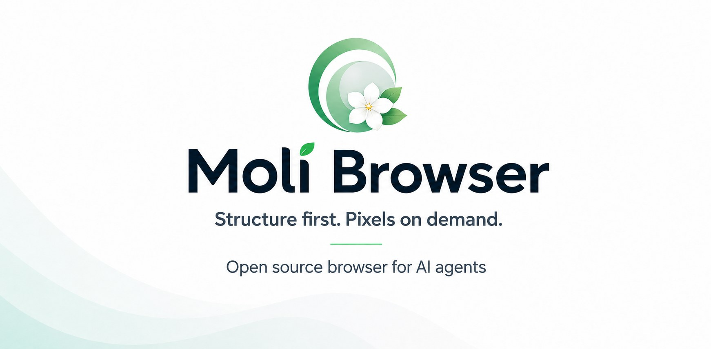
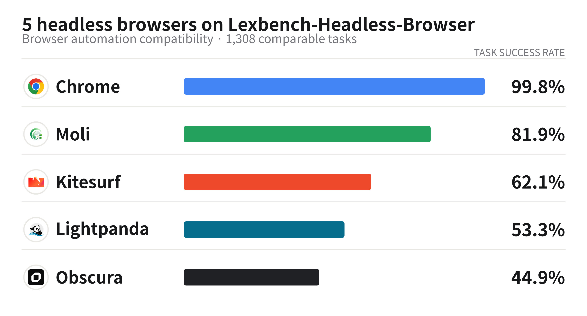
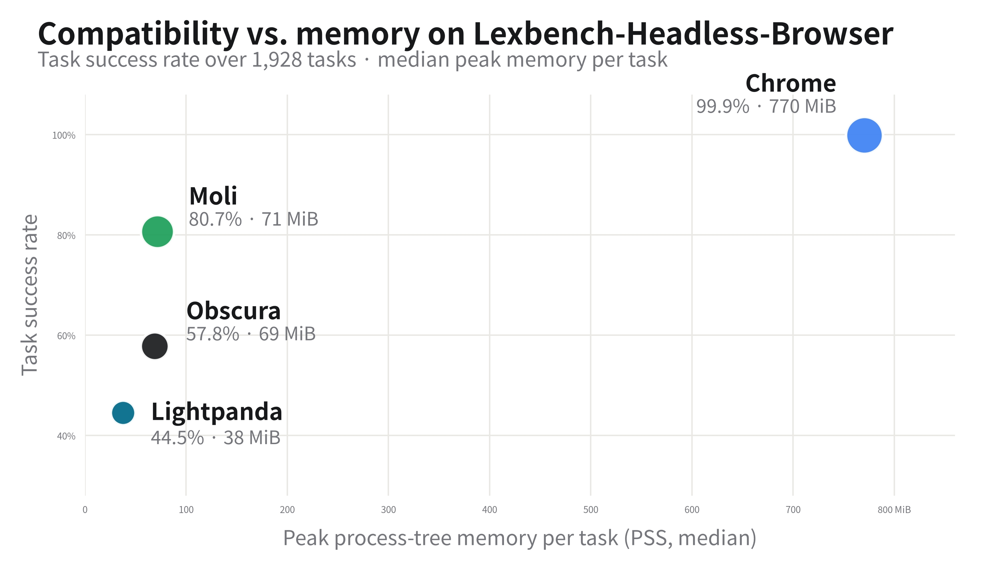

<p align="center">
  <picture>
    <source
      media="(prefers-color-scheme: dark)"
      srcset="../assets/moli-browser-banner-dark.jpg"
    />
    <source
      media="(prefers-color-scheme: light)"
      srcset="../assets/moli-browser-banner.jpg"
    />
    
  </picture>
</p>

<h1 align="center">Moli</h1>

<p align="center">
  <a href="../README.md">English</a> |
  <a href="README.zh-CN.md">简体中文</a> |
  <a href="README.ja.md">日本語</a> |
  <a href="README.de.md">Deutsch</a> |
  <a href="README.fr.md">Français</a> |
  <a href="README.es.md">Español</a> |
  <strong>한국어</strong>
</p>

<p align="center">
  <a href="https://discord.gg/4eXGtdWWnq">
    
  </a>
  <a href="../assets/moli-feedback-wechat-group.png">
    
  </a>
</p>

<p align="center">
  <a href="https://www.producthunt.com/products/lexmount-browser?launch=moli-by-lexmount" target="_blank" rel="noopener noreferrer">
    <picture>
      <source media="(prefers-color-scheme: dark)" srcset="https://api.producthunt.com/widgets/embed-image/v1/top-post-badge.svg?post_id=moli-by-lexmount&amp;period=daily&amp;theme=dark" />
      
    </picture>
  </a>
  <a href="https://trendshift.io/repositories/128243?utm_source=trendshift-badge&amp;utm_medium=badge&amp;utm_campaign=badge-trendshift-128243" target="_blank" rel="noopener noreferrer">
    
  </a>
  <a href="https://trendshift.io/repositories/128243?utm_source=trendshift-badge&amp;utm_medium=badge&amp;utm_campaign=badge-trendshift-128243" target="_blank" rel="noopener noreferrer">
    
  </a>
</p>

Moli는 AI 에이전트를 위한 프로덕션 준비형 헤드리스 브라우저입니다. 필요할 때만
레이아웃과 렌더링을 수행하는 설계로, 완전한 브라우저 런타임과 가벼운 리소스
사용량을 함께 제공합니다.

Moli는 AI 에이전트가 웹페이지를 가져오고 추출하며, 웹을 검색하고, 브라우저 작업을
자동화할 수 있도록 돕습니다.

CLI, CDP, WebDriver Classic 또는 WebDriver BiDi로 사용할 수 있습니다.

Moli는 Linux, macOS, Windows를 지원합니다.

## 빠른 시작

AI 에이전트에게 다음 프롬프트를 전달하세요.

```text
https://github.com/lexmount/moli/tree/main/skills 아래의 스킬을 설치하고,
각 스킬의 안내에 따라 최신 사전 빌드 Moli 바이너리를 다운로드하여 설치한 다음,
moli-webfetch로 https://example.com을 가져와 결과를 보여 주세요.
```

### 직접 설치

Linux 또는 macOS:

```sh
curl --proto '=https' --tlsv1.2 -fsSL \
  https://github.com/lexmount/moli/releases/latest/download/moli-installer.sh | sh
```

Windows에서는 PowerShell에서 실행하세요.

```powershell
powershell -ExecutionPolicy ByPass -c "irm https://github.com/lexmount/moli/releases/latest/download/moli-installer.ps1 | iex"
```

## 예시

<p align="center">
  <a href="../assets/moli-game.jpg">
    
  </a>
</p>

<p align="center">
  <sub>Moli로 렌더링한 HTML5 게임을 Chrome DevTools로 실시간 검사하는 모습입니다.</sub>
</p>

<p align="center">
  <a href="../assets/moli-devtools-rust-lang.jpg">
    
  </a>
</p>

<p align="center">
  <sub>Moli로 렌더링한 rust-lang.org에서 현재 DOM, CSS, 기하 정보를 Chrome DevTools로 확인할 수 있습니다.</sub>
</p>

## CLI 사용법

### 페이지 추출

Moli의 기본 완료 전략으로 페이지를 Markdown으로 렌더링합니다.

```bash
moli fetch \
  --dump markdown \
  --wait-until done \
  https://example.com
```

또는 모델이 다루기 쉬운 간결한 시맨틱 트리를 바로 반환합니다.

```bash
moli fetch \
  --dump semantic_tree_text \
  --wait-selector body \
  https://example.com
```

시각적 출력이 필요하다면 온디맨드 레이아웃을 활성화해 뷰포트 PNG, 전체 문서 PNG,
또는 페이지 나눈 PDF를 작성합니다.

```bash
moli fetch --layout --dump screenshot https://example.com > page.png
moli fetch --layout --dump screenshot_full https://example.com > full-page.png
moli fetch --layout --dump pdf https://example.com > page.pdf
```

명시적 상호작용 뒤에 내보내려면 `--eval`(또는 `--eval-file`)과 `--dump`를 함께
사용하세요. 이 식은 페이지가 준비된 뒤 실행되며, 프로미스는 완료될 때까지 기다리고
진행 중인 탐색이 있으면 내보내기 전에 따릅니다. 반환값은 직렬화하지 않고 버립니다.
예외가 발생하면 덤프를 출력하지 않고 명령이 실패합니다.

```bash
moli fetch --eval 'document.querySelector("button.show-details").click()' \
  --dump markdown https://example.com
```

상호작용은 제공한 식만 수행합니다. `--dump` 없이 `--eval`을 사용하면 기존처럼 식의
값을 출력합니다.

출력 형식, 페이지 로드·응답 대기, 프로필, 프록시 설정, 리소스 정책, 추적 옵션을
포함한 전체 옵션 목록은 `fetch --help`에서 확인하세요.

### 자동화 서버 시작

```bash
# DOM 우선 워크로드를 위한 기본 자동화 서버
moli serve

# 실제 기하 정보, 좌표 입력, 스크린샷·스크린캐스트 표면 활성화
moli serve --layout

# 선택적 이미지, 글꼴, 오디오, 비디오, 미디어, 텍스트 트랙 리소스도 가져오기
moli serve --layout --resource
```

하나의 엔드포인트가 CDP, WebDriver Classic, WebDriver BiDi 세 프로토콜을 모두
제공합니다. Playwright는 CDP로 직접 연결할 수 있습니다.

```js
import { chromium } from "playwright";

const browser = await chromium.connectOverCDP("http://127.0.0.1:9222");
const context = browser.contexts()[0];
const page = context.pages()[0] ?? await context.newPage();

await page.goto("https://example.com");
console.log(await page.locator("body").innerText());

await browser.close();
```

[WebMCP playground](../moli-playground/webmcp/README.md)에는 웹사이트의 네이티브
WebMCP 도구를 나열하고 호출하는 CLI와 예약, 레스토랑, 피자 데모가 포함되어 있습니다.

## Moli를 선택하는 이유

에이전트 워크로드에는 다음 세 가지 특성이 가장 중요하며, Moli는 이를 함께 제공합니다.

- **완전한 기능** — 실제 JavaScript, DOM, CSS, 네트워킹, 스토리지, 레이아웃,
  스크린샷, 표준 자동화 프로토콜을 하나의 헤드리스 브라우저에 통합했습니다.
- **빠른 속도** — 대부분의 자동화 요청에는 시각적 렌더링이 필요하지 않으므로,
  구조 우선 작업은 레이아웃과 페인트를 완전히 건너뜁니다.
- **리소스 효율성** — 레이아웃과 픽셀은 필요할 때만 생성하므로, Moli가 완전히
  렌더링된 시각 상태를 계속 유지하고 갱신할 필요가 없습니다.

실제 브라우저 자동화 작업에 필요한 것은 지속해서 렌더링되는 시각 세계가 아니라
페이지 구조인 경우가 많습니다. Moli는 네이티브 DOM과 스타일 상태를 단일 진실 공급원으로
삼고, 정말 필요한 작업에서만 레이아웃 또는 소프트웨어 페인트를 실행합니다.

| 에이전트 요청 | Moli의 동작 |
| --- | --- |
| HTML/Markdown 추출, DOM 질의, JS 실행, 네트워크·스토리지 검사 | 브라우저 런타임 상태를 직접 읽으며 레이아웃이나 페인트를 실행하지 않음 |
| 요소의 상자 읽기, 좌표 히트 테스트, 좌표 입력 전송 | 레이아웃을 한 번 계산하고 최신 고정 레이아웃 트리만 보존 |
| 스크린샷 캡처 | 현재 DOM과 스타일에서 다시 빌드하고, 고정 트리를 교체하여 새 프레임을 렌더링한 뒤 페인트 상태를 폐기 |
| 스크린캐스트 폴링 | 생성 메타데이터만 비교하며, 변경이 없으면 프레임을 내보내지 않고 변경이 있으면 새 프레임을 다시 빌드 |

<p align="center">
  <a href="../assets/moli_ondemand_rendering_flow.svg">
    
  </a>
</p>

Moli는 여전히 V8, CSS, 레이아웃, 텍스트 셰이핑, 히트 테스트, 소프트웨어 페인트 등을
포함하는 완전한 기능 집합을 갖추고 있습니다. 차이는 시각적 작업을 *언제* 실행하고,
그 결과를 *얼마나 오래* 보존하느냐뿐입니다. 이 비용 모델은 크롤링, 브라우저 사용
에이전트, 검색 파이프라인, 평가 환경, 강화 학습 워크로드에 특히 적합합니다.

## 현재 기능

- **완전한 웹 런타임** — 스트리밍 HTML 파싱, 네이티브 DOM, V8 JavaScript,
  모듈·타이머·마이크로태스크·이벤트, iframe과 워커, CSS 캐스케이드,
  Fetch/XHR/WebSocket, 쿠키, WebCrypto, 프로필 범위 스토리지(localStorage,
  IndexedDB, OPFS)를 제공합니다.
- **추출에 최적화된 출력** — CLI가 HTML, Markdown, JSON, 시맨틱 텍스트 트리,
  프레임 인식 직렬화를 직접 생성하며, 선택자·스크립트·응답 대기와 네트워크 추적을
  지원합니다.
- **통합 자동화 바이너리** — CDP, WebDriver Classic, WebDriver BiDi가 동일한
  커널과 스케줄러를 공유합니다. 별도의 ChromeDriver, geckodriver, 브라우저 설치가
  필요하지 않습니다.
- **요청 시 실제 시각 기능** — `--layout`을 추가하면 전체 상자 구성, Taffy 레이아웃,
  Parley 텍스트 레이아웃, 레이아웃 기반 히트 테스트·입력, 뷰포트 스크린샷,
  저주기 CPU 렌더링 DevTools 스크린캐스트 프레임을 활성화합니다.
- **제어 가능한 운영 옵션** — 프로필, 쿠키, HTTP 캐시, 프록시, 리소스 패밀리,
  연결 제한, 시간 제한, 사설 네트워크 정책, 사용자 에이전트 재정의, 진단 로깅,
  네트워크 진단을 모두 제공합니다.

## Moli와 Lexmount의 관계

Moli는 Lexmount가 공개한 오픈 소스 헤드리스 브라우저이며, Lexmount Browser는 Moli를
중심으로 구축된 관리형 클라우드 런타임과 제어 플레인입니다.

**Lexmount Browser 없이도 오픈 소스 헤드리스 브라우저의 모든 기능을 사용할 수 있습니다.**

## 비용 제어

Moli에서 비용이 큰 브라우저 작업은 명시적으로 활성화해야 하며, 기본으로는 절대
활성화되지 않습니다.

| 모드 또는 옵션 | 동작 |
| --- | --- |
| 기본값 | `LayoutPolicy::Mock` — 실제 레이아웃이나 페인트 없이 호환 가능한 형식의 결정론적 기하 정보를 반환 |
| `--layout` | `LayoutPolicy::OnDemand` — 실제 레이아웃, 기하 정보, 히트 테스트, 좌표 입력, 스크린샷, 스크린캐스트 |
| `--resource` | 선택적인 모든 시각·미디어 리소스 패밀리 가져오기 |
| `--image`, `--font`, `--audio`, `--video`, `--media`, `--text-track` | 특정 선택적 리소스 패밀리 하나 활성화 |
| `--profile-dir`, `--http-cache-dir`, `--cookie-file` | 워크로드에 필요한 영속성을 선택적으로 활성화 |

레이아웃은 지속해서 관리되는 상태가 아니라 온디맨드 스냅샷입니다. 첫 번째 기하 정보
요청(콜드 스타트)은 현재 DOM과 스타일에서 작업 레이아웃 트리를 빌드하고, 표준 기하
정보를 불변의 DOM 독립적 `FrozenLayoutTree`로 고정한 뒤 최신 트리만 보존합니다.
페이지가 변경된 뒤에도 일반 기하 정보 읽기는 이를 재사용할 수 있습니다. 스크린샷은
항상 고정 트리를 다시 빌드하고 교체합니다. 각 스크린캐스트 구독은 불투명한 시각 상태
토큰만 기억합니다. 토큰이 바뀌지 않으면 폴링 시 프레임을 내보내지 않고, 바뀌면 새
프레임을 빌드합니다. 페인트 결과는 재사용하지 않습니다.

## 아키텍처

Moli는 Chromium 래퍼가 아닌 독립형 브라우저 커널입니다. Rust로 작성되었고 자체적인
소유권 및 생명주기 규칙을 가지며, 다음 구성 요소를 사용합니다.

- `libcurl` — 네트워크 전송과 다중 요청 런타임
- `html5ever` — HTML 파싱
- `rusty_v8` / V8 — JavaScript 실행
- Servo/Stylo — 선택자, 캐스케이드, 계산된 스타일
- Taffy + Parley — 상자 및 텍스트 레이아웃
- AnyRender/Vello CPU, `usvg`, Rust 이미지 생태계 — 소프트웨어 렌더링

문서와 스타일의 단일 진실 공급원은 네이티브 DOM과 Stylo 통합입니다. 실제 새로고침은
이 공급원에서 임시 작업 트리를 새로 빌드하고, 필요하면 새 페인트 스냅샷 하나를 생성해
소비한 뒤, 정식 상자·프래그먼트 기하 정보를 간결한 `FrozenLayoutTree`로 고정합니다.
그런 다음 작업 트리, 스타일 borrow, 레이아웃 캐시, 진단, 페인트 상태를 버립니다.
스크린캐스트 토큰에는 레이아웃이나 페인트 데이터가 아닌 생성 메타데이터만 들어갑니다.
소스 조회와 히트 테스트 후보는 질의 시 고정 트리에서 파생합니다. 시스템에는 증분식으로
관리되는 레이아웃 트리, 손상 그래프, 보존형 디스플레이 목록, GPU 컴포지터, 영구 창이
없습니다.

## 벤치마크

다음 측정값은 Moli의 현재 기능 범위를 보여 줍니다. 실제 웹사이트, 자동화 클라이언트,
Chromium/WPT 동작 검사, 대규모 nextest 회귀 테스트 모음을 다룹니다.

### 혼합 공개 웹 크롤 테스트

이 테스트는 중국과 국제 주요 사이트의 공개 URL 192개를 다룹니다. JavaScript 실행 뒤
의미 있는 콘텐츠를 생성해야만 페이지를 성공으로 계산합니다. HTTP 200, 챌린지 페이지,
로그인 차단벽, 빈 응답, 셸만 있는 애플리케이션은 성공으로 계산하지 않습니다.

| 브라우저 | 유효 페이지 | 성공률 | 중앙 시간 | 중앙 RSS |
| --- | ---: | ---: | ---: | ---: |
| **Moli** | **103** | **53.6%** | **1.43초** | **73 MiB** |
| Chrome Headless | 101 | 52.6% | 1.43초 | 773 MiB |
| Lightpanda | 85 | 44.3% | 0.97초 | 40 MiB |
| Obscura | 57 | 29.7% | 1.30초 | 39 MiB |

### 에이전트 워크로드 예시

| 지표 | Moli | Chromium |
| --- | ---: | ---: |
| CDP 준비 | 34.85 ms | 169.37 ms |
| 에피소드 활성 p50 | 33.40 ms | 57.13 ms |
| 최대 PSS | 102.46 MiB | 348.82 MiB |
| 최대 프로세스 / 스레드 수 | 1 / 24 | 11 / 123 |

### WPT 테스트

Moli의 에이전트 브라우저 범위를 검증하는 현재 WPT 선택 항목에서, 전체 실행 한 번이
**161만 2천 개 테스트**를 통과했습니다.

### Lexbench-Headless-Browser에서의 Moli 성능

전체 [Lexbench-Headless-Browser](https://github.com/lexmount/Lexbench-Headless-Browser)
코퍼스에는 원시 CDP, Playwright·Puppeteer·Selenium을 포함한 13개 고정 자동화 도구,
웹 플랫폼 의미 체계를 다루는 1,928개 작업이 있습니다. 원격 엔드포인트로만 제공되는
Kitesurf를 포함하기 위해, 아래 차트는 비교 가능한 1,308개 작업을 사용합니다. 모든
브라우저는 같은 작업 선택 규칙을 따릅니다.

<picture>
  <source media="(prefers-color-scheme: dark)" srcset="../assets/lexbench-five-engine-caliber-b-dark.jpg">
  
</picture>

**Moli 0.1.1은 1,071개 작업을 통과해 성공률 81.88%를 기록했으며**, 62.08%의
Kitesurf, 53.29%의 Lightpanda, 44.88%의 Obscura보다 앞섰습니다. 기준 엔진인 Chrome은
99.85%에 도달했습니다. Kitesurf는 k=1로 실행했고, 다루지 못한 작업은 통과하지 못한
것으로 계산했습니다. 원격 서비스의 재현 조건은 로컬 바이너리와 다릅니다. 전체 결과는
벤치마크의 [다섯 엔진 보고서](https://github.com/lexmount/Lexbench-Headless-Browser/blob/kitesurf-eval/docs/reports/five-engine-report-20260813.md)를
참조하세요.

<picture>
  <source media="(prefers-color-scheme: dark)" srcset="../assets/lexbench-efficiency-map-dark.jpg">
  
</picture>

Kitesurf는 원격 서비스이므로 CPU, 메모리, 프로세스 수를 측정할 수 없습니다. 따라서
리소스 비교에는 로컬 엔진 네 개만 포함합니다. 별도의 557개 작업 실행에는 네 엔진이
모두 완료한 작업만 들어갑니다. Moli의 중앙 CPU 시간은 **100.6 ms**이고 중앙 최대
메모리는 **92 MiB**였습니다. Chrome은 각각 **687 ms**, **697 MiB**를 기록했습니다.
Moli는 Chrome CPU 시간의 약 15%, 최대 메모리의 약 13%를 사용했습니다. 방법론은
[리소스 카드](https://github.com/lexmount/Lexbench-Headless-Browser/blob/main/docs/reports/resource-card-20260812.md)를
참조하세요.

## 프로젝트 범위

Moli는 문서에서 정의한 에이전트 브라우저 시나리오 안에서 프로덕션 준비가 되었으며,
계속 개발 중입니다.

현재 의도적으로 두지 않는 범위는 다음과 같습니다.

- GUI 브라우저, 영구 창, GPU 컴포지터, 보존형 다중 프레임 페인트 아키텍처
- Chrome과의 픽셀 단위 일치, 고충실도 Canvas/WebGL/미디어 재생
- `--layout`은 소프트웨어 스크린샷과 글꼴이 포함된 네이티브 CDP/CLI PDF 생성을
  지원하지만, 모든 Chrome 스크린샷 또는 인쇄 모드를 구현하지는 않음

지원하지 않는 프로토콜 경로는 명시적 오류를 반환합니다. Moli는 브라우저 동작, 이벤트,
네트워크 관찰, 시각적 결과가 발생한 것처럼 가장하지 않습니다.

## 스타 기록

시간 단위로 생성되는 [lexmount/moli-metrics](https://github.com/lexmount/moli-metrics)의
스타 기록입니다.

<picture>
  <source media="(prefers-color-scheme: dark)" srcset="https://raw.githubusercontent.com/lexmount/moli-metrics/main/assets/star-history-dark.svg">
  
</picture>

## 라이선스

파일 또는 디렉터리에 별도의 명시가 없다면, 이 프로젝트는 [Apache License 2.0](../LICENSE-APACHE)
또는 [MIT License](../LICENSE-MIT) 중 하나를 선택해 사용할 수 있습니다. 별도 라이선스가
적용되는 서드파티 구성 요소와 픽스처에는 각 라이선스와 고지가 적용됩니다.
[`license-metadata.json`](../license-metadata.json)에는 기계가 읽을 수 있는 기본 메타데이터가
기록되어 있으며, 추가 배포 고지는 [`licenses/`](../licenses/)에 모여 있습니다.
