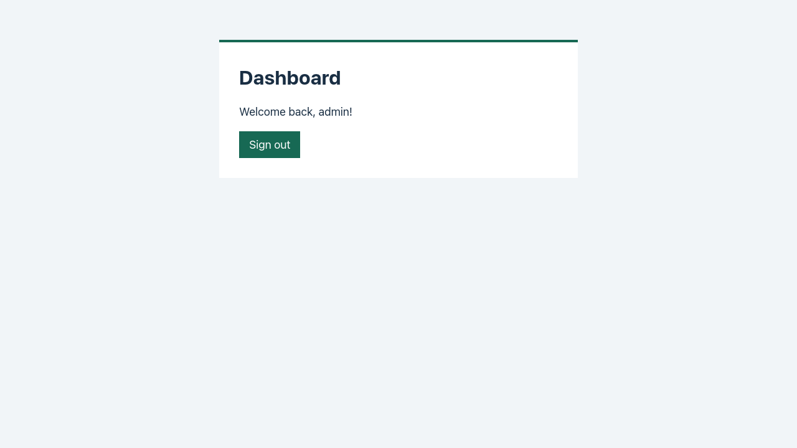

# Testing sign-in with e2e in a local Moli browser

What happens if someone opens a bookmarked dashboard after signing out? This example uses e2e and a local Moli browser to check a Node.js app with a cookie-based session. One test submits a wrong password and checks that the dashboard stays protected. The other signs in, reopens the dashboard, takes a screenshot, and signs out. Opening the same URL again must bring the user back to the sign-in page.

## Run the example

Install Node.js 22.22.3 or later in the 22.x line, or Node.js 24.8.0 or later. Install Moli for your platform and make sure the `moli` command is on your PATH. The demo includes a test account. [Moli installation guide](https://github.com/lexmount/moli#direct-installation)

Download or clone the example. From the directory containing `e2e.config.ts`, run the following commands.

```sh
moli --version
npm ci
npm test
```

e2e starts the app at `http://127.0.0.1:4271` and launches Moli on a free local port. Both stop when the run finishes. If port 4271 is busy, run `PORT=4272 npm test` on macOS or Linux.

## What a passing run looks like

The terminal shows `2 passed` and prints the screenshot path. The image below comes from the Moli 1.1.26 run, after the test reopened the dashboard using its session cookie. The test then signed out and checked that the same URL redirected to the sign-in page. The full report is in `.e2e-moli/report.json`.



## Use your own sign-in page

Start your app separately. In `e2e.config.ts`, keep `engine: web({ browser: moli() })` and replace the target’s entire `app` block, including its startup command, with the origin of your running app. For a development server on port 3000, use this target configuration.

```ts
{
  name: 'moli',
  engine: web({ browser: moli() }),
  app: { url: 'http://127.0.0.1:3000' },
}
```

Edit `tests/sign-in.e2e.ts` to match your app. For example, if your form is at `/sign-in` and opens `/account`, replace `/login` and `/dashboard` in both the navigation steps and the expected URLs. If the form asks for an email address, change `getByLabel('Username')` to `getByLabel('Email')` and use a test account for your app. Update the button names, error message, and signed-in greeting to match the page. Run `npm test` again. Your app stays running after the tests finish. [Moli integration guide](https://e2e.com/docs/integrations/moli)

## Versions and source

Both tests passed on Moli 1.1.19 and 1.1.26 on macOS arm64 with Node.js 24.22.0, e2e 0.23.1, and `@e2e-dev/web` 0.16.0.

The demo adapts the sign-in flow from e2e’s testbed. The four provider files in `vendor/moli/` come from the merged Moli integration and include the upstream license and notice. The example is licensed under Apache-2.0. [Upstream testbed](https://github.com/e2e-inc/e2e/tree/29a0261775fc362aa26e7ea0fe53e671c864dbc1/apps/testbed) · [Provider at commit `29a0261`](https://github.com/e2e-inc/e2e/tree/29a0261775fc362aa26e7ea0fe53e671c864dbc1/packages/moli/src) · [Integration PR #1843](https://github.com/e2e-inc/e2e/pull/1843)
