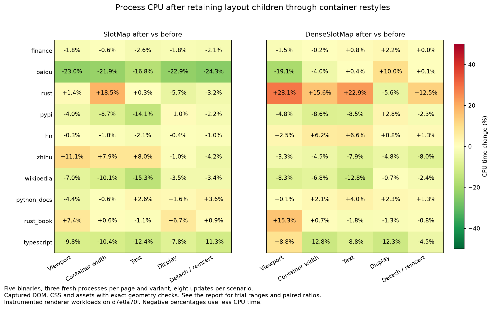
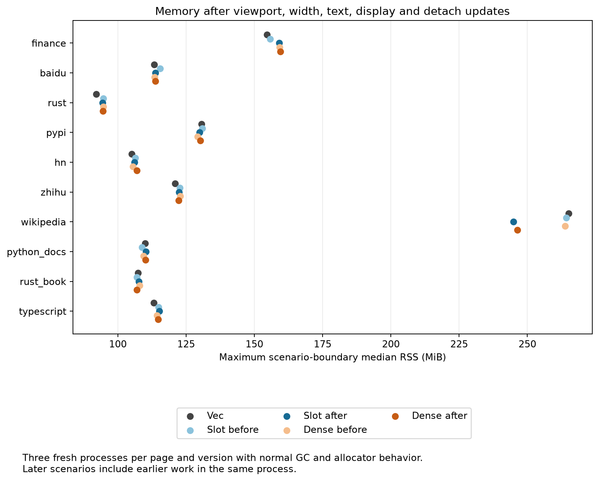

# Retaining layout children through container restyles

All 150 fresh-process trials passed across 10 captured pages and 6,000 measured updates. Vec, both previous arena binaries and both updated binaries are tested together in the same cohort.

Compatible block, flow-root, flex and grid containers refresh their styles and generated children while preserving eligible descendants. Bare inline items refresh their projected style when leaving item layout. Compatible list items retain their content and rebuild markers before counters are resolved. Numeric layout starts from the geometry already on each box and saves a feedback snapshot when scrollbar controls can trigger correction. Numeric cache compaction uses stored owner keys and rewrites moved slots. Overflow and projection reuse resolved box references.

The same initialized DOM, CSS and assets are replayed with application scripts inert. All five versions use fresh processes, rotated order, identical settings and DPR 1. Each scenario warms once, then runs eight updates in two cycles. These measurements cover synchronous layout of the captured pages.

Each update forces geometry. Up to 1,000 visible rectangles, body/target bounds, viewport and DOM/text counts match exactly between variants and rounds. Each family restores its starting state. Missing assets, failures and geometry differences remain failed records. No forced GC or allocator trim is used.

CPU comes from the POSIX all-thread process clock. CPU activity uses 100% for one logical CPU. Full geometry collection runs between timed steps. CPU time includes deferred or background work that falls within a timed step. RSS/PSS are sampled every 100 ms and at scenario boundaries. Later memory phases include earlier work. Kernel high-water covers the whole process lifetime. Three observations per page and variant give a range for checking repeatability.

## CPU changes

Equal-page geometric mean of per-page median CPU ratios. Negative values use less CPU time. All percentages are calculated from this cohort.

| Scenario | Slot after vs before | Dense after vs before | Slot after vs Vec | Dense after vs Vec |
|---|---:|---:|---:|---:|
| Viewport resize | -3.5% | +1.0% | -9.3% | -11.3% |
| Container width | -3.2% | -1.5% | +1.1% | -0.9% |
| Text changes | -5.7% | -1.0% | -0.5% | -1.1% |
| Display changes | -3.7% | -0.8% | +0.5% | -2.8% |
| Detach / reinsert | -5.0% | -0.4% | -0.5% | -0.4% |

## Reading the results

Both backends improve in all three same-round comparisons for Viewport resize, Container width, Text changes, Display changes.

Both variants use less CPU than Vec for viewport resize in all three matched rounds. The DenseSlotMap viewport ratio versus the previous binary is +1.0% using independent medians and ranges from −3.7% to −0.3% using matched rounds. The different aggregation is visible on the small Rust homepage, where two unusually fast previous DenseSlotMap trials can drive the per-page median.

Across pages, the median change in maximum scenario-boundary RSS is SlotMap after -0.27 MiB (page range -19.36 … +3.25) and DenseSlotMap after +0.27 MiB (page range -17.48 … +1.42).

On wikipedia, SlotMap after changes viewport-boundary RSS from 256.32 to 237.11 MiB. Its largest scenario-boundary median changes from 264.17 to 244.82 MiB. DenseSlotMap after changes viewport-boundary RSS from 256.96 to 235.41 MiB. Its largest scenario-boundary median changes from 263.87 to 246.39 MiB. Vec uses 219.13 MiB at the viewport boundary and 265.13 MiB at its largest scenario boundary.

On the Wiki viewport workload, retaining compatible children raises the average retained box count per update from 40 to 13,032. The temporary count before compaction falls from 36,594 to 23,600, avoiding an arena capacity growth step. Inline preparation falls by about 21 ms per update on each backend. Box construction and numeric layout remain the largest native phases.

A separate Wiki viewport warm-up pair sampled `/proc/<pid>/smaps` for the DenseSlotMap release binaries. The anonymous box values mapping changed from 95.0 to 47.5 MiB in virtual size and from 53.98 to 35.98 MiB resident. This pair measures the allocation affected by the lower pre-compaction box count.

## Memory across the five scenarios

MiB at the largest of the five scenario-boundary RSS medians for each page and version. Trials use normal GC and allocator behavior. The numeric files also include PSS, kernel high-water and JS heap used/total per scenario.

| Page | Vec | Slot before | Slot after | Dense before | Dense after |
|---|---:|---:|---:|---:|---:|
| finance | 154.59 | 155.84 | 159.08 | 159.27 | 159.56 |
| baidu | 113.37 | 115.42 | 113.70 | 113.51 | 113.76 |
| rust | 92.13 | 94.70 | 94.45 | 94.72 | 94.56 |
| pypi | 130.63 | 130.96 | 129.95 | 129.17 | 130.26 |
| hn | 105.07 | 106.36 | 106.08 | 105.55 | 106.96 |
| zhihu | 120.95 | 122.65 | 122.33 | 122.78 | 122.21 |
| wikipedia | 265.13 | 264.17 | 244.82 | 263.87 | 246.39 |
| python_docs | 110.04 | 108.80 | 110.23 | 109.45 | 110.13 |
| rust_book | 107.38 | 106.98 | 107.66 | 107.96 | 107.01 |
| typescript | 113.18 | 114.92 | 115.12 | 114.33 | 114.70 |

### Wiki viewport measurements

Medians across three fresh processes. CPU activity is the ratio of process CPU time to elapsed time during the measured updates. Peak RSS covers the process through the viewport scenario.

| Variant | CPU ms/update | CPU activity | Warm-up RSS MiB | End RSS MiB | End PSS MiB | Kernel peak RSS MiB |
|---|---:|---:|---:|---:|---:|---:|
| Vec | 277.54 | 99.55% | 214.71 | 219.13 | 215.99 | 286.07 |
| SlotMap before | 247.76 | 99.57% | 249.65 | 256.32 | 253.08 | 309.76 |
| DenseSlotMap before | 241.48 | 98.99% | 250.00 | 256.96 | 253.71 | 310.66 |
| SlotMap after | 230.38 | 99.38% | 230.96 | 237.11 | 232.40 | 294.46 |
| DenseSlotMap after | 221.43 | 99.56% | 231.02 | 235.41 | 231.73 | 294.46 |

## Viewport resize

Median process CPU time per update across three fresh processes per variant and page.

| Page | Vec | Slot before → after | Dense before → after | Slot RSS before → after MiB | Dense RSS before → after MiB |
|---|---:|---:|---:|---:|---:|
| finance | 92.972 | 83.626 → 82.142 | 82.733 → 81.528 | 155.25 → 154.61 | 154.91 → 155.49 |
| baidu | 8.534 | 10.679 → 8.219 | 9.922 → 8.024 | 104.56 → 104.47 | 104.54 → 104.57 |
| rust | 10.150 | 8.588 → 8.710 | 6.801 → 8.715 | 87.23 → 87.05 | 87.25 → 87.08 |
| pypi | 20.919 | 19.167 → 18.407 | 18.949 → 18.044 | 128.43 → 127.18 | 128.32 → 127.32 |
| hn | 24.219 | 22.274 → 22.215 | 22.077 → 22.620 | 101.77 → 101.62 | 101.57 → 101.91 |
| zhihu | 23.292 | 19.967 → 22.179 | 20.330 → 19.668 | 114.88 → 114.23 | 114.99 → 114.38 |
| wikipedia | 277.537 | 247.760 → 230.377 | 241.480 → 221.426 | 256.32 → 237.11 | 256.96 → 235.41 |
| python_docs | 19.915 | 17.809 → 17.034 | 16.397 → 16.411 | 105.06 → 104.88 | 105.57 → 105.69 |
| rust_book | 13.685 | 12.561 → 13.493 | 12.152 → 14.014 | 100.54 → 100.52 | 100.50 → 100.61 |
| typescript | 15.863 | 16.857 → 15.206 | 13.575 → 14.771 | 109.87 → 109.27 | 110.23 → 109.44 |

## Container width

Median process CPU time per update across three fresh processes per variant and page.

| Page | Vec | Slot before → after | Dense before → after | Slot RSS before → after MiB | Dense RSS before → after MiB |
|---|---:|---:|---:|---:|---:|
| finance | 67.498 | 72.117 → 71.681 | 70.528 → 70.360 | 151.11 → 150.82 | 149.50 → 149.55 |
| baidu | 5.233 | 7.219 → 5.639 | 5.475 → 5.254 | 111.27 → 109.23 | 109.26 → 109.44 |
| rust | 4.937 | 3.944 → 4.672 | 3.947 → 4.564 | 90.38 → 90.43 | 90.57 → 90.55 |
| pypi | 19.782 | 20.235 → 18.479 | 20.779 → 18.987 | 128.74 → 124.14 | 123.12 → 124.41 |
| hn | 14.755 | 15.698 → 15.542 | 14.649 → 15.559 | 97.31 → 97.30 | 97.33 → 98.25 |
| zhihu | 10.449 | 10.704 → 11.547 | 10.778 → 10.297 | 117.76 → 107.68 | 118.07 → 117.18 |
| wikipedia | 272.285 | 290.437 → 261.063 | 276.678 → 257.879 | 260.94 → 242.25 | 259.77 → 246.36 |
| python_docs | 14.512 | 15.311 → 15.213 | 15.258 → 15.571 | 108.48 → 110.23 | 109.08 → 108.53 |
| rust_book | 9.546 | 9.845 → 9.906 | 9.716 → 9.787 | 103.82 → 105.59 | 103.87 → 103.86 |
| typescript | 9.996 | 10.171 → 9.111 | 10.435 → 9.099 | 114.28 → 113.58 | 112.30 → 112.07 |

## Text changes

Median process CPU time per update across three fresh processes per variant and page.

| Page | Vec | Slot before → after | Dense before → after | Slot RSS before → after MiB | Dense RSS before → after MiB |
|---|---:|---:|---:|---:|---:|
| finance | 38.156 | 41.198 → 40.128 | 39.565 → 39.893 | 155.84 → 159.08 | 159.27 → 159.56 |
| baidu | 3.755 | 4.862 → 4.047 | 3.825 → 3.839 | 115.42 → 113.70 | 113.51 → 113.76 |
| rust | 5.822 | 5.724 → 5.739 | 4.675 → 5.747 | 94.16 → 94.00 | 94.20 → 94.06 |
| pypi | 13.987 | 13.471 → 11.568 | 13.763 → 12.588 | 130.96 → 129.95 | 129.17 → 130.26 |
| hn | 12.542 | 13.537 → 13.253 | 12.617 → 13.453 | 105.18 → 105.14 | 105.33 → 105.06 |
| zhihu | 8.101 | 8.013 → 8.657 | 8.393 → 7.727 | 114.99 → 115.07 | 115.09 → 114.42 |
| wikipedia | 186.131 | 202.960 → 171.964 | 192.262 → 167.584 | 261.19 → 244.06 | 261.77 → 242.74 |
| python_docs | 14.249 | 14.836 → 15.227 | 14.326 → 14.895 | 104.54 → 105.75 | 105.20 → 104.57 |
| rust_book | 9.070 | 9.295 → 9.191 | 9.178 → 9.016 | 98.42 → 99.77 | 98.88 → 98.65 |
| typescript | 9.894 | 10.297 → 9.023 | 10.678 → 9.740 | 110.13 → 108.54 | 107.69 → 107.93 |

## Display changes

Median process CPU time per update across three fresh processes per variant and page.

| Page | Vec | Slot before → after | Dense before → after | Slot RSS before → after MiB | Dense RSS before → after MiB |
|---|---:|---:|---:|---:|---:|
| finance | 36.504 | 39.519 → 38.815 | 37.448 → 38.271 | 154.05 → 152.12 | 152.26 → 151.78 |
| baidu | 4.317 | 4.927 → 3.800 | 3.747 → 4.121 | 106.03 → 102.62 | 102.34 → 103.56 |
| rust | 5.006 | 4.844 → 4.568 | 3.885 → 3.668 | 94.70 → 94.45 | 94.72 → 94.56 |
| pypi | 12.023 | 11.641 → 11.754 | 12.024 → 12.360 | 122.84 → 122.71 | 123.02 → 122.47 |
| hn | 11.287 | 12.045 → 11.995 | 11.915 → 12.015 | 106.36 → 106.08 | 105.55 → 106.96 |
| zhihu | 11.147 | 11.460 → 11.349 | 10.989 → 10.467 | 118.03 → 117.82 | 118.60 → 117.67 |
| wikipedia | 138.563 | 147.386 → 142.217 | 139.826 → 138.884 | 264.17 → 244.82 | 263.87 → 246.39 |
| python_docs | 10.313 | 10.843 → 11.021 | 10.560 → 10.800 | 108.79 → 110.05 | 109.45 → 109.52 |
| rust_book | 8.455 | 8.751 → 9.341 | 8.667 → 8.552 | 105.72 → 107.02 | 105.55 → 106.29 |
| typescript | 8.109 | 8.444 → 7.783 | 8.740 → 7.667 | 113.78 → 113.52 | 112.64 → 112.95 |

## Detach / reinsert

Median process CPU time per update across three fresh processes per variant and page.

| Page | Vec | Slot before → after | Dense before → after | Slot RSS before → after MiB | Dense RSS before → after MiB |
|---|---:|---:|---:|---:|---:|
| finance | 41.186 | 43.268 → 42.351 | 41.832 → 41.848 | 152.46 → 150.61 | 149.09 → 150.60 |
| baidu | 6.821 | 9.199 → 6.966 | 6.879 → 6.887 | 108.93 → 105.36 | 106.31 → 105.45 |
| rust | 4.764 | 4.445 → 4.302 | 4.082 → 4.593 | 88.00 → 87.58 | 87.78 → 87.88 |
| pypi | 15.940 | 15.615 → 15.274 | 16.674 → 16.284 | 128.39 → 124.34 | 127.54 → 125.82 |
| hn | 12.381 | 12.686 → 12.556 | 12.471 → 12.638 | 98.99 → 98.73 | 97.57 → 100.18 |
| zhihu | 12.363 | 11.989 → 11.482 | 11.991 → 11.035 | 122.65 → 122.33 | 122.78 → 122.21 |
| wikipedia | 146.494 | 157.282 → 151.986 | 151.937 → 148.254 | 261.04 → 242.19 | 261.83 → 241.44 |
| python_docs | 10.837 | 11.336 → 11.744 | 10.941 → 11.088 | 108.80 → 110.05 | 109.41 → 110.13 |
| rust_book | 8.366 | 8.651 → 8.726 | 8.603 → 8.530 | 106.98 → 107.66 | 107.96 → 107.01 |
| typescript | 7.704 | 8.209 → 7.281 | 7.983 → 7.627 | 114.92 → 115.12 | 114.33 → 114.70 |

## Work retained during viewport updates

Average retained boxes / reused IFC contexts per update, then median across runs. Viewport changes invalidate numeric outputs and retain eligible shaped inputs.

| Page | Slot before | Slot after | Dense before | Dense after |
|---|---:|---:|---:|---:|
| finance | 1237.5 / 167.1 | 1237.5 / 167.1 | 1237.5 / 167.1 | 1237.5 / 167.1 |
| baidu | 54.0 / 10.0 | 54.0 / 10.0 | 56.5 / 10.0 | 56.5 / 10.0 |
| rust | 76.0 / 13.4 | 76.0 / 13.4 | 112.5 / 22.8 | 112.5 / 22.8 |
| pypi | 36.2 / 5.1 | 36.2 / 5.1 | 344.5 / 24.4 | 344.5 / 24.4 |
| hn | 705.0 / 46.5 | 705.0 / 46.5 | 705.0 / 46.5 | 705.0 / 46.5 |
| zhihu | 640.0 / 133.0 | 640.0 / 133.0 | 653.0 / 133.0 | 653.0 / 133.0 |
| wikipedia | 40.0 / 0.5 | 40.0 / 0.5 | 13032.0 / 177.5 | 13032.0 / 177.5 |
| python_docs | 40.5 / 1.5 | 40.5 / 1.5 | 57.5 / 1.9 | 57.5 / 1.9 |
| rust_book | 75.5 / 7.0 | 75.5 / 7.0 | 75.5 / 7.0 | 75.5 / 7.0 |
| typescript | 131.2 / 22.6 | 131.2 / 22.6 | 276.2 / 50.5 | 276.2 / 50.5 |

## Box storage during viewport updates

The capacity column reports the largest arena capacity observed in each window, then takes the median across processes. Box counts come from native trace events before compaction. RSS columns use the same viewport warm-up and final boundaries.

| Page | Backend | Capacity before → after | Pre-compaction boxes before → after | RSS after warm-up before → after MiB | RSS after updates before → after MiB |
|---|---|---:|---:|---:|---:|
| finance | SlotMap after | 8,191 → 8,191 | 7,606 → 7,601 | 150.12 → 149.96 | 155.25 → 154.61 |
| finance | DenseSlotMap after | 8,192 → 8,192 | 7,606 → 7,601 | 150.16 → 150.16 | 154.91 → 155.49 |
| baidu | SlotMap after | 511 → 511 | 437 → 433 | 93.13 → 93.24 | 104.56 → 104.47 |
| baidu | DenseSlotMap after | 512 → 512 | 437 → 433 | 93.22 → 93.08 | 104.54 → 104.57 |
| rust | SlotMap after | 1,023 → 1,023 | 652 → 524 | 81.71 → 81.46 | 87.23 → 87.05 |
| rust | DenseSlotMap after | 1,024 → 1,024 | 652 → 524 | 81.71 → 81.46 | 87.25 → 87.08 |
| pypi | SlotMap after | 4,095 → 4,095 | 2,682 → 1,897 | 120.10 → 119.15 | 128.43 → 127.18 |
| pypi | DenseSlotMap after | 4,096 → 4,096 | 2,682 → 1,897 | 120.02 → 118.95 | 128.32 → 127.32 |
| hn | SlotMap after | 2,047 → 2,047 | 1,513 → 1,513 | 89.53 → 89.66 | 101.77 → 101.62 |
| hn | DenseSlotMap after | 2,048 → 2,048 | 1,513 → 1,513 | 89.58 → 89.63 | 101.57 → 101.91 |
| zhihu | SlotMap after | 2,047 → 2,047 | 1,209 → 1,183 | 106.23 → 105.70 | 114.88 → 114.23 |
| zhihu | DenseSlotMap after | 2,048 → 2,048 | 1,209 → 1,183 | 106.23 → 105.70 | 114.99 → 114.38 |
| wikipedia | SlotMap after | 65,535 → 32,767 | 36,594 → 23,600 | 249.65 → 230.96 | 256.32 → 237.11 |
| wikipedia | DenseSlotMap after | 65,536 → 32,768 | 36,594 → 23,600 | 250.00 → 231.02 | 256.96 → 235.41 |
| python_docs | SlotMap after | 4,095 → 4,095 | 2,254 → 2,188 | 94.17 → 94.05 | 105.06 → 104.88 |
| python_docs | DenseSlotMap after | 4,096 → 4,096 | 2,254 → 2,188 | 94.70 → 94.21 | 105.57 → 105.69 |
| rust_book | SlotMap after | 2,047 → 2,047 | 1,560 → 1,560 | 90.14 → 90.24 | 100.54 → 100.52 |
| rust_book | DenseSlotMap after | 2,048 → 2,048 | 1,560 → 1,560 | 90.04 → 90.12 | 100.50 → 100.61 |
| typescript | SlotMap after | 1,023 → 1,023 | 877 → 718 | 98.12 → 97.40 | 109.87 → 109.27 |
| typescript | DenseSlotMap after | 1,024 → 1,024 | 877 → 718 | 98.20 → 97.45 | 110.23 → 109.44 |

## Viewport native phase timings

Median native wall milliseconds per update, before → after. The trace measures the wall time of each phase. The process CPU comparison includes all threads.

| Page | Backend | Box tree | Inline preparation | Numeric layout | Projection |
|---|---|---:|---:|---:|---:|
| finance | SlotMap after | 33.802 → 33.593 | 9.629 → 9.616 | 25.158 → 24.763 | 4.791 → 4.814 |
| finance | DenseSlotMap after | 33.647 → 33.432 | 9.835 → 9.611 | 24.997 → 24.525 | 4.582 → 4.441 |
| baidu | SlotMap after | 5.039 → 3.558 | 0.669 → 0.555 | 1.392 → 1.091 | 0.309 → 0.229 |
| baidu | DenseSlotMap after | 4.684 → 3.554 | 0.628 → 0.548 | 1.309 → 1.069 | 0.294 → 0.222 |
| rust | SlotMap after | 2.939 → 3.019 | 1.031 → 0.914 | 2.279 → 2.308 | 0.598 → 0.618 |
| rust | DenseSlotMap after | 2.185 → 3.015 | 0.860 → 0.917 | 1.776 → 2.313 | 0.423 → 0.622 |
| pypi | SlotMap after | 5.705 → 5.601 | 2.393 → 2.041 | 2.945 → 2.848 | 1.084 → 1.061 |
| pypi | DenseSlotMap after | 5.703 → 5.608 | 2.428 → 2.067 | 2.964 → 2.830 | 1.086 → 1.084 |
| hn | SlotMap after | 8.736 → 8.794 | 1.341 → 1.333 | 8.322 → 8.141 | 1.297 → 1.387 |
| hn | DenseSlotMap after | 8.630 → 8.964 | 1.304 → 1.344 | 8.267 → 8.297 | 1.311 → 1.361 |
| zhihu | SlotMap after | 8.206 → 9.093 | 1.685 → 1.913 | 5.421 → 5.851 | 1.142 → 1.334 |
| zhihu | DenseSlotMap after | 8.325 → 8.220 | 1.736 → 1.672 | 5.515 → 5.348 | 1.175 → 1.194 |
| wikipedia | SlotMap after | 97.894 → 97.195 | 43.935 → 22.204 | 61.992 → 60.072 | 25.183 → 29.924 |
| wikipedia | DenseSlotMap after | 97.862 → 95.148 | 42.984 → 21.625 | 61.388 → 59.848 | 23.418 → 25.757 |
| python_docs | SlotMap after | 4.670 → 4.454 | 5.428 → 4.904 | 3.752 → 3.441 | 1.637 → 1.417 |
| python_docs | DenseSlotMap after | 4.381 → 4.396 | 4.815 → 4.807 | 3.325 → 3.329 | 1.319 → 1.369 |
| rust_book | SlotMap after | 4.733 → 5.343 | 1.567 → 1.736 | 3.096 → 3.390 | 1.016 → 1.123 |
| rust_book | DenseSlotMap after | 4.630 → 5.508 | 1.537 → 1.746 | 3.029 → 3.431 | 1.071 → 1.167 |
| typescript | SlotMap after | 5.516 → 4.970 | 2.033 → 1.252 | 5.494 → 5.165 | 1.101 → 1.047 |
| typescript | DenseSlotMap after | 4.295 → 4.968 | 1.647 → 1.267 | 4.530 → 5.124 | 0.926 → 1.065 |

## Aggregate paired rounds

Equal-page geometric mean of each round's CPU ratios.

| Scenario | SlotMap vs prior (rounds 1 / 2 / 3) | DenseSlotMap vs prior | SlotMap vs Vec | DenseSlotMap vs Vec |
|---|---:|---:|---:|---:|
| Viewport resize | -1.8% / -3.9% / -5.3% | -0.3% / -0.9% / -3.7% | -7.3% / -13.8% / -8.4% | -12.6% / -13.7% / -9.8% |
| Container width | -0.5% / -2.3% / -7.4% | -3.0% / -0.4% / -5.5% | +3.7% / +0.9% / +0.7% | +1.4% / -1.1% / +3.0% |
| Text changes | -5.2% / -5.1% / -9.5% | -2.8% / -0.1% / -0.7% | -1.0% / -2.3% / -1.3% | -2.0% / -3.1% / +3.1% |
| Display changes | -4.6% / -2.2% / -4.8% | -1.4% / -2.0% / -4.2% | -1.1% / -1.3% / +4.6% | -4.1% / -2.4% / +1.5% |
| Detach / reinsert | -4.5% / -3.0% / -4.0% | -1.0% / -1.5% / +0.1% | -4.2% / -2.4% / +3.8% | -3.7% / -4.2% / +5.4% |

## Same-round CPU ratios

Median (min … max) percentage change versus the same backend before the followup. All original trials remain included.

| Page | Scenario | SlotMap | DenseSlotMap |
|---|---|---:|---:|
| finance | Viewport resize | -1.2% (-2.3 … +0.1) | -1.1% (-1.8 … -0.7) |
| finance | Container width | -0.6% (-2.4 … +1.3) | -1.0% (-2.9 … +3.5) |
| finance | Text changes | -2.3% (-4.4 … +0.5) | +0.8% (-1.8 … +3.8) |
| finance | Display changes | -1.4% (-3.0 … -1.2) | +0.2% (-0.1 … +3.7) |
| finance | Detach / reinsert | -1.6% (-3.5 … -1.2) | -0.9% (-2.7 … +1.0) |
| baidu | Viewport resize | -23.0% (-23.1 … -19.7) | -17.4% (-19.6 … +0.1) |
| baidu | Container width | -21.5% (-24.0 … -5.1) | -12.4% (-25.6 … +2.3) |
| baidu | Text changes | -16.4% (-17.2 … -15.9) | +0.4% (-1.6 … +3.6) |
| baidu | Display changes | -25.6% (-26.3 … -8.1) | +8.3% (-6.0 … +12.3) |
| baidu | Detach / reinsert | -23.7% (-26.6 … -22.1) | -3.6% (-20.9 … +2.7) |
| rust | Viewport resize | -1.1% (-4.6 … +1.4) | +27.7% (-4.9 … +29.6) |
| rust | Container width | +20.3% (-26.1 … +21.0) | +15.3% (-9.0 … +17.2) |
| rust | Text changes | +0.3% (-26.1 … +23.1) | +24.6% (+7.2 … +24.8) |
| rust | Display changes | -5.3% (-25.5 … +20.1) | -3.6% (-31.0 … +15.8) |
| rust | Detach / reinsert | -3.2% (-17.7 … +15.6) | +16.9% (-9.1 … +17.4) |
| pypi | Viewport resize | -3.2% (-7.8 … -0.2) | -6.4% (-7.8 … -4.1) |
| pypi | Container width | -8.1% (-8.7 … -6.9) | -7.6% (-14.7 … -6.5) |
| pypi | Text changes | -14.1% (-14.9 … -13.8) | -8.3% (-19.6 … -6.9) |
| pypi | Display changes | -1.9% (-1.9 … +1.0) | +4.0% (-2.6 … +6.6) |
| pypi | Detach / reinsert | +0.2% (-3.4 … +1.2) | -7.3% (-8.1 … +9.2) |
| hn | Viewport resize | -1.0% (-4.2 … +10.6) | +2.5% (+0.6 … +4.8) |
| hn | Container width | -2.1% (-7.2 … +2.0) | -1.1% (-1.3 … +8.2) |
| hn | Text changes | -7.1% (-13.4 … +5.1) | +0.1% (-1.1 … +16.8) |
| hn | Display changes | +0.4% (-1.7 … +4.2) | +1.3% (-0.6 … +3.4) |
| hn | Detach / reinsert | +1.6% (-1.4 … +2.4) | +1.0% (-1.6 … +1.3) |
| zhihu | Viewport resize | +10.4% (-1.6 … +14.3) | -0.1% (-6.8 … +0.0) |
| zhihu | Container width | +10.8% (-4.2 … +13.0) | +0.2% (-9.3 … +16.4) |
| zhihu | Text changes | +8.0% (-6.5 … +10.3) | -7.9% (-9.0 … -0.8) |
| zhihu | Display changes | -2.2% (-5.9 … -1.0) | -7.9% (-8.2 … -4.8) |
| zhihu | Detach / reinsert | -1.9% (-5.3 … +1.1) | -5.7% (-8.0 … -0.9) |
| wikipedia | Viewport resize | -7.0% (-8.9 … -6.4) | -8.9% (-10.9 … -7.2) |
| wikipedia | Container width | -7.5% (-10.3 … -7.3) | -6.6% (-8.3 … -6.6) |
| wikipedia | Text changes | -15.3% (-19.4 … -13.2) | -13.7% (-14.4 … -12.8) |
| wikipedia | Display changes | -4.7% (-7.7 … -2.4) | -0.8% (-2.1 … -0.7) |
| wikipedia | Detach / reinsert | -5.2% (-7.7 … +0.3) | -1.4% (-6.5 … -0.4) |
| python_docs | Viewport resize | -2.4% (-9.2 … -0.9) | -3.3% (-12.5 … +1.7) |
| python_docs | Container width | -2.3% (-3.3 … +4.7) | +1.5% (-3.2 … +2.6) |
| python_docs | Text changes | +2.4% (+0.2 … +9.3) | +2.3% (-3.0 … +6.3) |
| python_docs | Display changes | +1.6% (+0.6 … +2.1) | -1.2% (-12.1 … +2.4) |
| python_docs | Detach / reinsert | +3.6% (-0.1 … +15.9) | +0.6% (-4.0 … +1.3) |
| rust_book | Viewport resize | +13.9% (-4.1 … +17.9) | +1.2% (-13.2 … +17.0) |
| rust_book | Container width | +7.1% (-0.2 … +18.3) | +1.1% (-0.7 … +1.9) |
| rust_book | Text changes | -0.0% (-1.1 … +0.0) | +1.0% (-4.0 … +24.6) |
| rust_book | Display changes | +1.7% (-1.3 … +26.6) | -0.4% (-4.9 … +5.3) |
| rust_book | Detach / reinsert | +0.2% (+0.1 … +13.8) | -1.3% (-1.4 … +16.0) |
| typescript | Viewport resize | -9.8% (-17.8 … -4.6) | +0.8% (-2.5 … +10.8) |
| typescript | Container width | -10.6% (-15.6 … -8.4) | -11.8% (-26.9 … +11.9) |
| typescript | Text changes | -12.4% (-16.1 … -11.0) | -10.0% (-11.2 … -8.8) |
| typescript | Display changes | -8.4% (-13.4 … -7.8) | -8.0% (-27.9 … -1.9) |
| typescript | Detach / reinsert | -11.1% (-13.8 … -6.2) | -8.7% (-9.5 … +22.5) |

## Rust homepage timing repeat

The Rust homepage showed the largest DenseSlotMap CPU increase in the matrix. A separate five-round repeat uses the same snapshot, binaries and CPU affinity with 24 updates per scenario. All 25 fresh processes and 3,000 timed updates pass the geometry checks. The table shows the median and range of the five same-round CPU changes against the previous binary.

| Scenario | SlotMap | DenseSlotMap |
|---|---:|---:|
| Viewport resize | -18.2% (-31.0% … +37.5%) | +8.8% (-9.7% … +54.4%) |
| Container width | -12.7% (-32.7% … +28.8%) | +5.7% (-27.5% … +99.4%) |
| Text changes | -11.2% (-34.5% … +74.8%) | +0.7% (-10.6% … +95.0%) |
| Display changes | -23.7% (-31.4% … +70.0%) | -3.4% (-13.2% … +57.2%) |
| Detach / reinsert | -11.2% (-34.9% … +82.2%) | +20.2% (-29.9% … +103.8%) |

The longer repeat gives a median same-round viewport increase of 8.8% for DenseSlotMap, with four increases in five rounds. Its text result crosses zero and the median increase falls to 0.7%. The unchanged Vec binary also spans 7.39–10.93 ms per viewport update in these runs. These measurements leave the size and cause of the Rust homepage viewport slowdown unresolved.

## Validation and scope

The Rust variants independently pass formatting, workspace/all-target/all-feature Clippy and full default Nextest before their Rust commits. Exact counts and source revisions are recorded in the PR. Snapshot admission is separate from formal medians. The numeric files record binary, control and input hashes, run-level observations, phase timings, CPU activity and RSS/PSS. The base remains d7e0a70f, so current-main synchronization and revalidation are required before merging either alternative.

Run the paired suite with `../compare_layout_followup.py`, using the same ten archived DOM/CSS/asset snapshots and the five release binaries identified in `validation.json`. The `slotmap_before` and `dense_before` files identify the previous experiments. The harness uses three repetitions and eight updates per scenario. Exact viewport geometry also passed for every visible element on the Wiki snapshot in separate four-step runs for each backend and its Vec control.

[Per-trial CPU, memory, and native phase measurements](measurements.csv) · [Validation and build provenance](validation.json)
