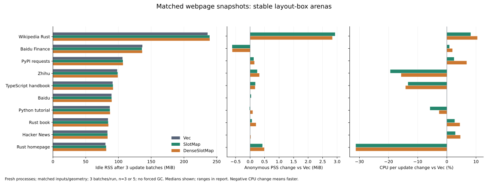
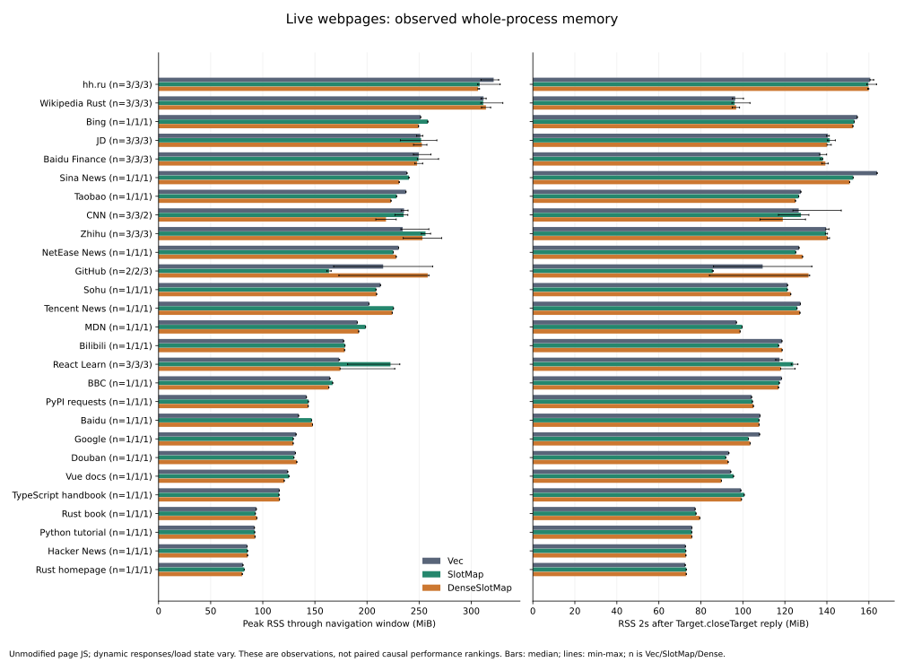
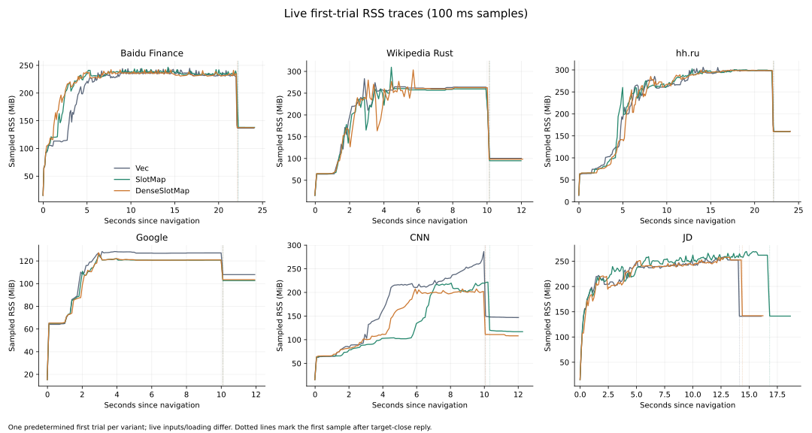

# Extended layout-arena webpage and memory comparison

Baseline: main `d7e0a70f28e42db46b04f716b750466c272bad02`. The Vec, SlotMap and DenseSlotMap executable SHA-256 hashes are unchanged from the initial experiment. This update changes benchmark scripts and reports only.

## Findings after the expanded and confirmation rounds

- There is no general memory reduction. Most matched snapshot RSS differences are around MiB; Wiki adds about 3 MiB in either prototype.
- Rust homepage, Zhihu and TypeScript retain useful CPU gains, while Wiki retains a slower CPU median after five rounds. Finance remains within substantial timing spread. Python tutorial's initial apparent regression changes sign after confirmation; it is not a stable regression finding.
- Native phase data shows that cheaper remapping/retention can be outweighed by numeric-layout/projection work. These prototypes should remain drafts; this dataset does not justify switching all webpages to either store.

**Scope:** separate matched structural-layout experiments from unmodified live-page observations. The live network/app state is not byte-identical between fresh navigations; low memory with incomplete loading is not a container optimization.

Matched snapshots: 108/108 successful fresh-process runs across 10 websites. Three batches per run: 48 updates per batch, reduced to 12 for documents above 5,000 body elements. Three rotating-order repetitions per implementation; Finance, Wikipedia and Python tutorial receive two additional balanced confirmation rounds after regressions were observed. All original rounds remain in the analysis.

Live observations: 126/132 successful runs across 27 websites so far, out of 28 candidate websites. Each starts without injected scripts or Fetch interception. Initial windows are 8 seconds, or 20 seconds for Finance/hh.ru; another 2 seconds observes ongoing activity, then the target closes and memory is observed 2 seconds after the close reply.

## Controls and interpretation

- Same release binaries/features, 1280×720 viewport, DPR 1, Realtime, disabled HTTP cache, two Tokio workers, process affinity CPUs 3 and 4, native profiling enabled, fresh process and working directory per run.
- Memory sampled every 100 ms. RSS/PSS/private/anonymous measurements are Linux process measurements. Kernel VmHWM provides the reported observed-lifetime RSS high-water; PSS peaks and phase-specific peaks are sampled. No forced V8 GC or allocator trimming.
- Snapshot admission requires root element count and first 1,000 visible element rectangles to match the actual original capture. Variants must also match each other's snapshot text length, all recorded pulse bounds and final sampled geometry. Every requested replay resource must exist. Shadow DOM/nonempty child-document cases remain excluded, not replaced with smaller fake pages.
- Unmodified CSS is retained as original bytes when parsing it reproduces the active CSSOM; modified rules retain active CSSOM serialization. This fixes the earlier Wiki capture round trip that changed a figure border. The failed original capture/admission artifacts remain local.
- Initial live observations cover all 28 candidates. Before those measurements, followup selection was specified as Finance/Wikipedia/hh.ru, the five largest baseline initialization peak-RSS cases, and up to three largest absolute candidate idle-PSS deviations above 5%. Those cases receive two extra rounds. All other live cases remain exploratory single observations, labelled by n.
- Root HTTP errors and challenge documents are excluded from successful live summaries, with failed runs retained. Actual observation duration and root load-event completion are exported; slow command replies can extend wall time. Live memory differences are not causal evidence because responses, DOM and loading progress vary.
- Two new arena backends share identity/order separation, sparse IFC owner maps and stable-cache retention. This is a comparison of those migration prototypes with Vec, not an isolated allocator or per-box-size benchmark.

## Matched snapshot CPU and resident memory

CPU is the process user+system time per structural update, normalized over the three batches. Positive CPU changes mean slower. Memory is measured after the final workload and 2-second idle; n is per implementation.

| Page | n Vec/S/D | Vec CPU ms/update | SlotMap CPU Δ | Dense CPU Δ | Vec RSS MiB | SlotMap RSS | Dense RSS |
|---|---|---|---|---|---|---|---|
| Baidu Finance | 5/5/5 | 40.069 | +0.9% | +1.9% | 136.54 | 135.84 | 136.24 |
| Baidu | 3/3/3 | 2.500 | +0.0% | +0.0% | 89.46 | 89.50 | 89.75 |
| Rust homepage | 3/3/3 | 3.333 | -31.3% | -31.3% | 80.14 | 81.14 | 81.35 |
| PyPI requests | 3/3/3 | 11.250 | +2.5% | +6.8% | 106.20 | 106.74 | 106.93 |
| Hacker News | 3/3/3 | 12.014 | +2.9% | +4.6% | 83.18 | 83.32 | 83.46 |
| Zhihu | 3/3/3 | 9.306 | -19.4% | -15.7% | 98.07 | 98.83 | 99.04 |
| Wikipedia Rust article | 5/5/5 | 207.222 | +8.2% | +10.5% | 236.16 | 239.19 | 239.37 |
| Python tutorial | 5/5/5 | 15.625 | -5.8% | -2.7% | 86.84 | 86.96 | 87.22 |
| Rust book | 3/3/3 | 7.778 | +2.7% | +4.5% | 84.04 | 84.29 | 84.68 |
| TypeScript handbook | 3/3/3 | 8.333 | -13.3% | -14.2% | 91.13 | 91.60 | 91.79 |

## Construction savings versus numeric/publication work

These native timings are wall-clock durations per update; they do not sum to process CPU. Retention is nested in construction. Smaller remapping work alone does not imply a faster page.

| Page | Phase, ms/update | Vec | SlotMap | DenseSlotMap |
|---|---|---|---|---|
| Wikipedia Rust article | Compaction/retention | 15.848 | 14.971 | 15.715 |
| Wikipedia Rust article | Numeric layout | 81.035 | 85.690 | 87.880 |
| Wikipedia Rust article | Projection | 28.008 | 33.974 | 33.174 |
| Python tutorial | Compaction/retention | 1.192 | 1.089 | 1.177 |
| Python tutorial | Numeric layout | 4.065 | 3.775 | 3.862 |
| Python tutorial | Projection | 1.787 | 1.697 | 1.730 |
| Baidu Finance | Compaction/retention | 2.146 | 1.881 | 2.047 |
| Baidu Finance | Numeric layout | 17.390 | 16.694 | 16.869 |
| Baidu Finance | Projection | 4.538 | 5.046 | 5.068 |

RSS is not a census of live layout allocations: it includes code, V8, DOM, styles, fonts, caches and allocator residency. Both stable-ID implementations also preserve more IFC numeric cache data than the Vec baseline.

## Matched snapshot memory details

| Page | Vec PSS | SlotMap PSS | Dense PSS | Vec anonymous PSS | SlotMap anonymous | Dense anonymous |
|---|---|---|---|---|---|---|
| Baidu Finance | 131.99 | 131.96 | 132.11 | 65.94 | 65.32 | 65.33 |
| Baidu | 85.45 | 85.43 | 85.68 | 20.43 | 20.46 | 20.43 |
| Rust homepage | 76.53 | 77.58 | 77.78 | 14.48 | 14.91 | 14.97 |
| PyPI requests | 101.95 | 102.91 | 103.17 | 31.57 | 31.70 | 31.72 |
| Hacker News | 79.37 | 79.59 | 79.77 | 17.41 | 17.41 | 17.43 |
| Zhihu | 94.34 | 94.96 | 95.29 | 28.71 | 28.96 | 29.04 |
| Wikipedia Rust article | 231.60 | 235.18 | 235.49 | 165.85 | 168.78 | 168.69 |
| Python tutorial | 83.14 | 83.24 | 83.52 | 20.55 | 20.54 | 20.64 |
| Rust book | 80.41 | 80.74 | 81.00 | 16.62 | 16.69 | 16.83 |
| TypeScript handbook | 88.04 | 88.77 | 88.94 | 22.02 | 22.20 | 22.20 |

| Page | Vec peak RSS | SlotMap peak | Dense peak | Vec RSS after close | SlotMap after close | Dense after close |
|---|---|---|---|---|---|---|
| Baidu Finance | 147.07 | 146.62 | 146.87 | 76.86 | 76.71 | 77.09 |
| Baidu | 92.69 | 92.79 | 92.91 | 75.64 | 75.61 | 76.04 |
| Rust homepage | 80.89 | 81.90 | 82.02 | 71.68 | 72.10 | 72.35 |
| PyPI requests | 113.56 | 114.03 | 114.35 | 80.81 | 81.18 | 81.30 |
| Hacker News | 87.98 | 88.04 | 88.36 | 71.53 | 71.64 | 71.80 |
| Zhihu | 102.20 | 103.48 | 103.83 | 74.19 | 74.83 | 75.13 |
| Wikipedia Rust article | 294.90 | 297.93 | 298.16 | 78.36 | 78.69 | 78.63 |
| Python tutorial | 91.62 | 91.66 | 91.98 | 72.16 | 72.51 | 72.70 |
| Rust book | 87.43 | 87.82 | 87.97 | 73.28 | 73.54 | 73.74 |
| TypeScript handbook | 93.96 | 94.43 | 94.67 | 76.82 | 77.29 | 77.34 |

| Page | Vec batch 3 − batch 1 RSS | SlotMap Δ MiB | Dense Δ MiB |
|---|---|---|---|
| Baidu Finance | -0.41 | -0.66 | -2.33 |
| Baidu | +0.05 | +0.11 | +0.03 |
| Rust homepage | +0.14 | +0.07 | +0.14 |
| PyPI requests | +0.78 | +0.70 | +0.62 |
| Hacker News | -0.04 | -0.60 | -0.27 |
| Zhihu | +0.76 | +1.23 | +1.22 |
| Wikipedia Rust article | -1.28 | -1.45 | -3.18 |
| Python tutorial | +1.27 | +1.32 | +1.30 |
| Rust book | +1.60 | +0.64 | +0.69 |
| TypeScript handbook | +0.50 | +0.42 | +0.32 |

Three batches are a bounded retention check, not proof that a long-running browser cannot leak. RSS after target closure includes process-global code/font/network/allocator residency; it cannot by itself identify leaked DOM objects.

## Live navigation window memory

Values are whole-process medians where n>1, otherwise a single observation. Peak is kernel RSS high-water through the end of the initial navigation window. Each cell is MiB. No performance ranking is inferred from this table.

| Page | usable/attempted Vec ; S ; D | Vec window-end RSS | SlotMap RSS | Dense RSS | Vec peak | SlotMap peak | Dense peak |
|---|---|---|---|---|---|---|---|
| Baidu Finance | 3/3 ; 3/3 ; 3/3 | 237.3 | 234.1 | 237.0 | 249.7 | 249.4 | 248.1 |
| Baidu | 1/1 ; 1/1 ; 1/1 | 128.4 | 127.6 | 128.1 | 134.4 | 146.8 | 147.7 |
| Rust homepage | 1/1 ; 1/1 ; 1/1 | 80.8 | 81.2 | 80.3 | 80.9 | 82.2 | 80.3 |
| Google | 1/1 ; 1/1 ; 1/1 | 126.9 | 120.7 | 120.7 | 132.0 | 129.2 | 129.1 |
| Bing | 1/1 ; 1/1 ; 1/1 | 245.5 | 241.0 | 238.7 | 251.5 | 258.4 | 249.4 |
| Wikipedia Rust article | 3/3 ; 3/3 ; 3/3 | 259.0 | 259.8 | 259.7 | 311.8 | 311.5 | 314.1 |
| GitHub repository | 2/3 ; 2/3 ; 3/3 | 201.3 | 162.8 | 236.2 | 215.5 | 163.5 | 258.3 |
| MDN CSS | 1/1 ; 1/1 ; 1/1 | 169.8 | 178.5 | 172.5 | 190.7 | 198.6 | 192.0 |
| PyPI requests | 1/1 ; 1/1 ; 1/1 | 132.3 | 134.5 | 138.7 | 141.8 | 143.7 | 143.6 |
| Hacker News | 1/1 ; 1/1 ; 1/1 | 82.2 | 82.7 | 82.8 | 85.0 | 85.4 | 85.4 |
| BBC News | 1/1 ; 1/1 ; 1/1 | 158.0 | 157.8 | 156.6 | 164.5 | 167.0 | 163.3 |
| CNN | 3/3 ; 3/3 ; 2/3 | 223.4 | 216.6 | 210.5 | 235.5 | 235.1 | 218.2 |
| Sina News | 1/1 ; 1/1 ; 1/1 | 231.2 | 227.3 | 218.3 | 238.3 | 240.3 | 230.9 |
| NetEase News | 1/1 ; 1/1 ; 1/1 | 228.4 | 210.4 | 218.0 | 230.3 | 225.2 | 228.0 |
| Tencent News | 1/1 ; 1/1 ; 1/1 | 183.9 | 199.2 | 188.6 | 201.9 | 225.3 | 224.2 |
| Sohu | 1/1 ; 1/1 ; 1/1 | 202.1 | 201.6 | 203.2 | 212.9 | 208.7 | 209.2 |
| Douban | 1/1 ; 1/1 ; 1/1 | 123.4 | 122.4 | 123.0 | 131.3 | 129.8 | 132.6 |
| Zhihu | 3/3 ; 3/3 ; 3/3 | 210.6 | 210.9 | 211.8 | 234.3 | 256.1 | 253.2 |
| Bilibili | 1/1 ; 1/1 ; 1/1 | 159.9 | 160.8 | 161.6 | 177.6 | 178.8 | 178.5 |
| JD | 3/3 ; 3/3 ; 3/3 | 240.6 | 234.1 | 235.1 | 251.2 | 251.9 | 252.7 |
| Taobao | 1/1 ; 1/1 ; 1/1 | 187.4 | 187.6 | 187.2 | 237.4 | 228.4 | 223.0 |
| hh.ru | 3/3 ; 3/3 ; 3/3 | 298.6 | 298.7 | 299.1 | 321.5 | 308.1 | 306.6 |
| Python tutorial | 1/1 ; 1/1 ; 1/1 | 89.7 | 89.9 | 90.3 | 91.9 | 92.2 | 92.6 |
| Rust book | 1/1 ; 1/1 ; 1/1 | 89.8 | 90.0 | 92.1 | 93.8 | 92.8 | 94.3 |
| Vue docs | 1/1 ; 1/1 ; 1/1 | 119.5 | 119.8 | 113.6 | 123.9 | 125.1 | 120.5 |
| React Learn | 3/3 ; 3/3 ; 3/3 | 170.8 | 222.7 | 172.0 | 173.2 | 222.5 | 174.4 |
| TypeScript handbook | 1/1 ; 1/1 ; 1/1 | 114.0 | 114.1 | 114.0 | 115.8 | 115.6 | 116.0 |

## Live PSS and closure

| Page | Vec followup PSS | SlotMap PSS | Dense PSS | Vec closed RSS | SlotMap closed | Dense closed |
|---|---|---|---|---|---|---|
| Baidu Finance | 233.2 | 229.0 | 228.4 | 136.9 | 138.0 | 139.3 |
| Baidu | 124.4 | 123.8 | 124.4 | 108.2 | 107.7 | 107.7 |
| Rust homepage | 76.9 | 77.6 | 76.8 | 72.6 | 73.1 | 73.1 |
| Google | 123.1 | 116.8 | 117.0 | 107.9 | 102.7 | 103.5 |
| Bing | 240.7 | 235.9 | 233.9 | 154.5 | 153.0 | 152.4 |
| Wikipedia Rust article | 255.0 | 256.5 | 257.6 | 96.3 | 96.1 | 96.8 |
| GitHub repository | 197.9 | 159.8 | 231.5 | 109.4 | 85.7 | 131.3 |
| MDN CSS | 165.9 | 174.6 | 167.7 | 96.9 | 99.7 | 98.7 |
| PyPI requests | 128.7 | 128.7 | 129.8 | 104.1 | 104.6 | 105.0 |
| Hacker News | 78.4 | 78.0 | 78.8 | 72.7 | 72.8 | 72.9 |
| BBC News | 153.1 | 152.6 | 151.8 | 118.4 | 117.4 | 117.0 |
| CNN | 231.6 | 237.3 | 216.3 | 126.6 | 127.6 | 119.0 |
| Sina News | 230.6 | 220.1 | 219.6 | 163.9 | 152.6 | 150.9 |
| NetEase News | 215.3 | 208.4 | 215.2 | 126.7 | 125.2 | 128.4 |
| Tencent News | 175.6 | 174.9 | 176.8 | 127.4 | 125.8 | 127.2 |
| Sohu | 172.1 | 169.6 | 170.4 | 121.3 | 121.2 | 122.8 |
| Douban | 118.1 | 117.1 | 117.6 | 93.3 | 91.9 | 93.0 |
| Zhihu | 205.8 | 205.3 | 206.4 | 139.6 | 139.7 | 140.4 |
| Bilibili | 153.8 | 154.1 | 155.9 | 118.6 | 117.0 | 118.7 |
| JD | 239.3 | 225.9 | 221.4 | 140.5 | 141.4 | 140.1 |
| Taobao | 181.6 | 182.1 | 182.9 | 127.6 | 126.6 | 125.0 |
| hh.ru | 294.7 | 295.7 | 294.4 | 160.6 | 159.7 | 159.9 |
| Python tutorial | 86.2 | 86.4 | 86.6 | 75.7 | 75.7 | 75.7 |
| Rust book | 85.9 | 86.8 | 87.9 | 77.3 | 77.7 | 79.5 |
| Vue docs | 114.7 | 115.4 | 110.5 | 94.2 | 95.5 | 89.8 |
| React Learn | 175.1 | 190.2 | 176.5 | 117.5 | 123.9 | 118.1 |
| TypeScript handbook | 120.6 | 121.2 | 121.2 | 99.0 | 100.6 | 99.3 |

## Live load state and DOM variation

Loading counts indicate whether the root load event arrived within the initial window; DOM node counts come from the subsequent lightweight observation. A smaller unfinished document must not be interpreted as a memory win.

| Page | Vec load | Vec DOM nodes | SlotMap load | SlotMap DOM | Dense load | Dense DOM |
|---|---|---|---|---|---|---|
| Baidu Finance | 0/3 | 2168–2273 | 0/3 | 2166–2273 | 0/3 | 2166–2271 |
| Baidu | 1/1 | 420–420 | 1/1 | 420–420 | 1/1 | 420–420 |
| Rust homepage | 1/1 | 197–197 | 1/1 | 197–197 | 1/1 | 197–197 |
| Google | 1/1 | 611–611 | 1/1 | 479–479 | 1/1 | 479–479 |
| Bing | 1/1 | 445–445 | 1/1 | 445–445 | 1/1 | 441–441 |
| Wikipedia Rust article | 3/3 | 9920–9920 | 3/3 | 9920–10412 | 3/3 | 9920–9920 |
| GitHub repository | 1/2 | 3984–5002 | 0/2 | 3984–3984 | 2/3 | 3984–5002 |
| MDN CSS | 1/1 | 5023–5023 | 1/1 | 5023–5023 | 1/1 | 5023–5023 |
| PyPI requests | 1/1 | 4357–4357 | 1/1 | 4357–4357 | 1/1 | 4357–4357 |
| Hacker News | 1/1 | 795–795 | 1/1 | 795–795 | 1/1 | 795–795 |
| BBC News | 1/1 | 1297–1297 | 1/1 | 1297–1297 | 1/1 | 1297–1297 |
| CNN | 0/3 | 4358–4379 | 0/3 | 4355–4377 | 0/2 | 4366–4387 |
| Sina News | 0/1 | 3795–3795 | 0/1 | 3821–3821 | 0/1 | 3795–3795 |
| NetEase News | 1/1 | 5286–5286 | 1/1 | 5222–5222 | 1/1 | 5283–5283 |
| Tencent News | 1/1 | 1765–1765 | 1/1 | 1765–1765 | 1/1 | 1765–1765 |
| Sohu | 1/1 | 1440–1440 | 1/1 | 1445–1445 | 1/1 | 1426–1426 |
| Douban | 1/1 | 1284–1284 | 1/1 | 1284–1284 | 1/1 | 1284–1284 |
| Zhihu | 3/3 | 737–746 | 3/3 | 728–746 | 3/3 | 728–755 |
| Bilibili | 1/1 | 1399–1399 | 1/1 | 1399–1399 | 1/1 | 1399–1399 |
| JD | 3/3 | 2465–2492 | 3/3 | 2453–3189 | 3/3 | 2458–2482 |
| Taobao | 1/1 | 3962–3962 | 1/1 | 3970–3970 | 1/1 | 3964–3964 |
| hh.ru | 3/3 | 3585–3613 | 2/3 | 3585–3605 | 0/3 | 3583–3589 |
| Python tutorial | 1/1 | 625–625 | 1/1 | 625–625 | 1/1 | 625–625 |
| Rust book | 1/1 | 586–586 | 1/1 | 586–586 | 1/1 | 586–586 |
| Vue docs | 1/1 | 1173–1173 | 1/1 | 1167–1167 | 1/1 | 1173–1173 |
| React Learn | 3/3 | 2304–2304 | 3/3 | 2304–2304 | 3/3 | 2304–2304 |
| TypeScript handbook | 1/1 | 676–676 | 1/1 | 676–676 | 1/1 | 676–676 |

## Followups and exclusions

Live cases receiving extra rounds: Baidu Finance, Wikipedia Rust article, GitHub repository, CNN, Zhihu, JD, hh.ru, React Learn.

Stack Overflow and npm returned HTTP 403 in preliminary route checks and were not treated as successfully rendered pages. V2EX challenge/error runs and any further failed navigations remain explicit failed records. The Google and original Wiki snapshot admissions failed geometry checks; Wiki was re-captured after preserving unmodified CSS bytes, while Google remains live-only. Active-child-document and Shadow DOM cases are live-only.

| Snapshot candidate | Reason |
|---|---|
| Google | ['Snapshot changed original boxes'] |
| Bing | RuntimeError('Snapshot has 2 unsupported Shadow DOM roots') |
| Wikipedia Rust article | RuntimeError(['Snapshot changed original boxes']) |
| GitHub repository | RuntimeError('Snapshot has 1 unsupported Shadow DOM roots') |
| MDN CSS | RuntimeError('Snapshot has 22 unsupported Shadow DOM roots') |
| BBC News | RuntimeError(['CDP handler errors']) |
| CNN | RuntimeError(['CDP handler errors', 'Snapshot changed original nodes']) |
| Sina News | RuntimeError(['2 missing resources', 'CDP handler errors', 'Snapshot changed original nodes', 'Snapshot changed original boxes']) |
| NetEase News | RuntimeError(['CDP handler errors']) |
| Tencent News | RuntimeError(['CDP handler errors', 'Snapshot changed original nodes', 'Snapshot changed original boxes']) |
| Sohu | RuntimeError(['CDP handler errors']) |
| Douban | RuntimeError(['CDP handler errors']) |
| V2EX | RuntimeError('HTTP error or bot-challenge page') |
| Bilibili | RuntimeError(['CDP handler errors', 'Snapshot changed original nodes', 'Snapshot changed original boxes']) |
| JD | RuntimeError(['CDP handler errors', 'Snapshot changed original nodes', 'Snapshot changed original boxes']) |
| Taobao | RuntimeError(['CDP handler errors']) |
| hh.ru | RuntimeError(['1 missing resources', 'CDP handler errors', 'Snapshot changed original nodes', 'Snapshot changed original boxes']) |
| Vue docs | RuntimeError(['CDP handler errors']) |
| React Learn | RuntimeError(['CDP handler errors']) |

| Failed run | Classification |
|---|---|
| live-round1/01-v2ex-baseline | http_error |
| live-round1/01-v2ex-slotmap | http_error |
| live-round1/01-v2ex-dense | http_error |
| live-followups/02-github-slotmap | network_error |
| live-followups/02-github-baseline | network_error |
| live-followups/02-cnn-dense | incomplete |

## Reproduction and provenance

See [README.md](README.md), [common-pages.json](common-pages.json), [numeric records](results-extended-d7e0a70f.jsonl), and [measurements.csv](measurements.csv). Min/max ranges, all per-run metrics, binary/input/control hashes and observed phase durations accompany the numeric records. Raw page bodies, cookies, tracking URLs and response headers remain private local artifacts.

The Rust source/binaries remain unchanged from the independently validated SlotMap and DenseSlotMap variants (24,370 default tests passed each, 20 existing default skips; workspace Clippy and formatting passed). This task adds no Rust source or build metadata changes. The PRs remain alternative drafts on pinned main d7e0a70f and need synchronization before production merge.

[SlotMap #3793](https://github.com/lexmount/moli/pull/3793) · [DenseSlotMap #3795](https://github.com/lexmount/moli/pull/3795)

## Separate React memory anomaly diagnostics

The primary three live trials had a roughly 50 MiB anonymous-residency jump in two SlotMap trials and one DenseSlotMap trial, despite equal root node counts and total completed network bytes. Six extra read-only diagnostic trials are separate from all ranked medians; no GC was forced. They query document-isolate heap usage, Moli runtime counts and child execution-context DOM counts after the initial 8-second measurement point. The Vec baseline also shows high residency in this group. Heap use varies substantially, and the page contains a Sandpack child document and a dedicated worker. This is an unresolved live-memory variability signal, not proof of fixed arena overhead and not something silently discarded as noise.

| Diagnostic trial | RSS before diagnostics, MiB | Heap used, MiB | Heap total, MiB | Observed contexts |
|---|---|---|---|---|
| 01-baseline | 223.7 | 58.14 | 77.88 | 6 |
| 01-slotmap | 185.9 | 58.44 | 78.13 | 6 |
| 01-dense | 172.9 | 18.24 | 19.81 | 6 |
| 02-slotmap | 196.8 | 22.37 | 33.13 | 6 |
| 02-dense | 234.2 | 59.27 | 78.13 | 6 |
| 02-baseline | 171.3 | 18.22 | 19.56 | 6 |

The heap RPC and whole-process residency do not have identical scope. These readings do not apportion the remaining RSS to layout versus workers/allocator/code. Targeted allocation profiling would be needed for that attribution.
