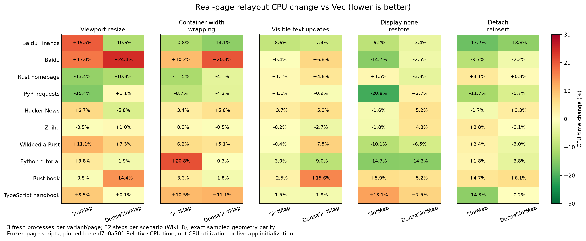
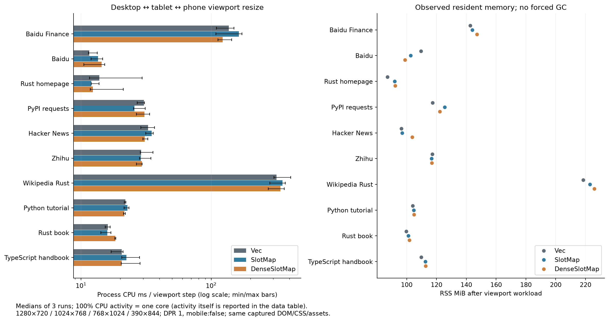

# Real-page relayout: Vec / SlotMap / DenseSlotMap

90/90 fresh-process trials passed original-capture fidelity, per-step cross-variant geometry and final-restoration checks. 10 pages have all 3 balanced-order rounds for every variant. The engine base and three release binaries are unchanged from the earlier reports.

This adds actual layout changes to the previous zero-height structural pulse. The same captured DOM, CSS and assets are replayed with application scripts inert. It measures renderer relayout, not live application resize handlers or network/initialization performance. All variants enable the same native layout tracing. Comparisons against Vec include the shared stable-identity migration; only SlotMap versus DenseSlotMap isolates the storage alias. These are Moli-versus-Moli comparisons; Chromium is not measured here.

Each process warms each scenario once, then performs 32 measured steps (8 for the 9,920-element Wiki article). Scenarios run in the same fixed sequence in all variants:

- Viewport: 1280×720 → 1024×768 → 768×1024 → 390×844 → 1280×720, repeating, DPR 1 and `mobile:false`. This changes layout/media-query constraints without changing the UA or emulating a mobile device.
- Container width: body width 960 / 640 / 1180 px / original, forcing wrapping on actual page content.
- Text: duplicate/triplicate 20 visible text nodes (or all available if fewer), then restore the original text.
- Display: hide a visible main-content subtree with `display:none`, then restore its original style.
- Detach: remove and reinsert the same main-content DOM subtree at its original location, exercising retired box identities and slot reuse.

Every step synchronously reads body and target bounds. Up to 1,000 visible element rectangles, body/target bounds, viewport, element count and text length are checked exactly between variants/repetitions, outside the timed window. Every scenario must change its observed state and restore the exact starting state. Original-capture geometry must still match before the workload, with no missing assets or substitutions. No geometry tolerance, forced GC or allocator trim is used.

CPU ms/step comes from the POSIX process CPU clock (nanosecond API, all threads), avoiding `/proc/stat`’s 10 ms quantization. Average CPU % = measured CPU time / elapsed time in those same per-step windows × 100; **100% is one core**, with affinity to two logical CPUs. Wall time includes the CDP update, synchronous layout and resource-probe overhead; geometry inspection and between-step idle are excluded. Inspection still allocates in the engine, and deferred GC/background work during a timed window is included in process CPU. CPU % measures activity, while CPU time measures work: similar near-100% busy values can still have very different step durations.

RSS/PSS are sampled every 100 ms and at phase boundaries. Scenario RSS below is after its final measured step; peak RSS is the kernel high-water since process start, not a per-scenario peak. Scenarios share a process in fixed order, so later memory points include earlier work. Numeric data includes min/max ranges, all formal trials, idle/after-close residency and hashes; response bodies, identifiers and page text remain local.

## CPU change by scenario

Equal-page geometric mean of per-page median CPU ratios; positive is slower. This is not a traffic-weighted total.

| Scenario | Pages | SlotMap CPU Δ | DenseSlotMap CPU Δ |
|---|---:|---:|---:|
| Viewport resize | 10 | +3.1% | +1.4% |
| Container width / wrapping | 10 | +2.0% | +1.3% |
| Visible text updates | 10 | -0.6% | +1.5% |
| Display none / restore | 10 | -5.7% | -0.7% |
| Detach / reinsert | 10 | -4.1% | -2.0% |

## Viewport resize

Medians of independent trials. Times are process CPU ms/step; CPU activity uses the same timed windows.

| Page | Vec CPU | Slot CPU | Dense CPU | Slot Δ | Dense Δ | CPU % Vec / Slot / Dense | RSS MiB Vec / Slot / Dense |
|---|---:|---:|---:|---:|---:|---:|---:|
| Baidu Finance | 136.707 | 163.429 | 122.271 | +19.5% | -10.6% | 98.0 / 91.0 / 97.4 | 142.65 / 144.09 / 147.08 |
| Baidu | 11.549 | 13.517 | 14.369 | +17.0% | +24.4% | 88.0 / 84.9 / 84.0 | 109.65 / 102.69 / 98.75 |
| Rust homepage | 13.835 | 11.981 | 12.341 | -13.4% | -10.8% | 86.2 / 85.4 / 84.1 | 87.10 / 91.94 / 92.24 |
| PyPI requests | 30.393 | 25.723 | 30.734 | -15.4% | +1.1% | 95.4 / 95.8 / 93.4 | 117.41 / 125.46 / 122.24 |
| Hacker News | 32.757 | 34.948 | 30.870 | +6.7% | -5.8% | 93.6 / 94.9 / 94.5 | 96.35 / 96.95 / 103.63 |
| Zhihu | 28.989 | 28.829 | 29.274 | -0.5% | +1.0% | 94.3 / 93.9 / 93.6 | 117.27 / 116.60 / 116.87 |
| Wikipedia Rust | 317.343 | 352.668 | 340.404 | +11.1% | +7.3% | 99.5 / 99.5 / 99.2 | 218.50 / 222.96 / 225.91 |
| Python tutorial | 21.930 | 22.764 | 21.505 | +3.8% | -1.9% | 93.3 / 92.9 / 93.0 | 104.10 / 104.67 / 104.90 |
| Rust book | 16.024 | 15.890 | 18.334 | -0.8% | +14.4% | 91.6 / 88.5 / 91.5 | 99.69 / 101.07 / 101.83 |
| TypeScript handbook | 20.515 | 22.263 | 20.529 | +8.5% | +0.1% | 92.7 / 91.0 / 91.4 | 109.67 / 112.47 / 112.71 |

## Container width / wrapping

Medians of independent trials. Times are process CPU ms/step; CPU activity uses the same timed windows.

| Page | Vec CPU | Slot CPU | Dense CPU | Slot Δ | Dense Δ | CPU % Vec / Slot / Dense | RSS MiB Vec / Slot / Dense |
|---|---:|---:|---:|---:|---:|---:|---:|
| Baidu Finance | 110.259 | 98.370 | 94.682 | -10.8% | -14.1% | 97.6 / 97.0 / 96.9 | 153.73 / 153.39 / 158.75 |
| Baidu | 7.444 | 8.205 | 8.955 | +10.2% | +20.3% | 81.2 / 82.6 / 82.6 | 111.62 / 112.29 / 107.86 |
| Rust homepage | 7.696 | 6.814 | 7.384 | -11.5% | -4.1% | 81.3 / 80.1 / 79.4 | 92.37 / 92.85 / 93.05 |
| PyPI requests | 30.513 | 27.857 | 29.191 | -8.7% | -4.3% | 96.1 / 95.7 / 96.6 | 120.60 / 122.27 / 124.84 |
| Hacker News | 19.539 | 20.209 | 20.625 | +3.4% | +5.6% | 91.8 / 92.1 / 92.0 | 105.10 / 106.81 / 104.18 |
| Zhihu | 13.847 | 13.952 | 13.779 | +0.8% | -0.5% | 89.1 / 90.2 / 88.6 | 125.07 / 124.63 / 125.55 |
| Wikipedia Rust | 314.103 | 333.718 | 330.252 | +6.2% | +5.1% | 99.4 / 99.6 / 99.5 | 257.92 / 259.71 / 261.50 |
| Python tutorial | 17.193 | 20.761 | 17.137 | +20.8% | -0.3% | 92.5 / 92.7 / 91.8 | 107.66 / 108.29 / 108.04 |
| Rust book | 11.023 | 11.418 | 10.822 | +3.6% | -1.8% | 88.3 / 89.9 / 87.5 | 96.80 / 101.03 / 100.72 |
| TypeScript handbook | 12.434 | 13.735 | 13.809 | +10.5% | +11.1% | 86.6 / 85.5 / 89.1 | 115.30 / 114.12 / 115.68 |

## Visible text updates

Medians of independent trials. Times are process CPU ms/step; CPU activity uses the same timed windows.

| Page | Vec CPU | Slot CPU | Dense CPU | Slot Δ | Dense Δ | CPU % Vec / Slot / Dense | RSS MiB Vec / Slot / Dense |
|---|---:|---:|---:|---:|---:|---:|---:|
| Baidu Finance | 66.027 | 60.347 | 61.129 | -8.6% | -7.4% | 95.5 / 96.0 / 96.3 | 159.93 / 158.68 / 156.80 |
| Baidu | 6.524 | 6.500 | 6.968 | -0.4% | +6.8% | 75.0 / 77.9 / 74.9 | 107.17 / 111.55 / 111.91 |
| Rust homepage | 8.527 | 8.618 | 8.918 | +1.1% | +4.6% | 82.2 / 83.4 / 80.3 | 90.90 / 87.84 / 89.43 |
| PyPI requests | 20.583 | 20.814 | 20.389 | +1.1% | -0.9% | 93.8 / 94.4 / 94.1 | 120.15 / 120.92 / 126.45 |
| Hacker News | 17.368 | 18.017 | 18.390 | +3.7% | +5.9% | 90.7 / 90.3 / 90.6 | 109.05 / 108.47 / 108.04 |
| Zhihu | 11.334 | 11.310 | 11.024 | -0.2% | -2.7% | 86.0 / 85.8 / 85.8 | 125.17 / 125.36 / 125.97 |
| Wikipedia Rust | 228.052 | 227.243 | 245.212 | -0.4% | +7.5% | 99.5 / 99.4 / 99.2 | 257.47 / 262.57 / 260.75 |
| Python tutorial | 17.651 | 17.128 | 15.956 | -3.0% | -9.6% | 92.8 / 91.1 / 91.0 | 109.38 / 108.99 / 108.97 |
| Rust book | 10.820 | 11.092 | 12.509 | +2.5% | +15.6% | 88.0 / 86.8 / 89.2 | 110.35 / 110.84 / 99.32 |
| TypeScript handbook | 13.838 | 13.637 | 13.595 | -1.5% | -1.8% | 88.0 / 88.0 / 88.1 | 115.92 / 117.99 / 115.07 |

## Display none / restore

Medians of independent trials. Times are process CPU ms/step; CPU activity uses the same timed windows.

| Page | Vec CPU | Slot CPU | Dense CPU | Slot Δ | Dense Δ | CPU % Vec / Slot / Dense | RSS MiB Vec / Slot / Dense |
|---|---:|---:|---:|---:|---:|---:|---:|
| Baidu Finance | 57.891 | 52.569 | 55.899 | -9.2% | -3.4% | 95.6 / 96.0 / 95.4 | 158.68 / 158.92 / 160.13 |
| Baidu | 6.641 | 5.663 | 6.474 | -14.7% | -2.5% | 74.9 / 78.6 / 76.5 | 108.01 / 110.46 / 110.36 |
| Rust homepage | 7.674 | 7.792 | 7.381 | +1.5% | -3.8% | 81.3 / 79.7 / 77.1 | 87.62 / 94.50 / 94.98 |
| PyPI requests | 20.620 | 16.336 | 21.177 | -20.8% | +2.7% | 93.2 / 93.0 / 91.0 | 119.33 / 125.70 / 123.14 |
| Hacker News | 15.683 | 15.435 | 16.494 | -1.6% | +5.2% | 91.5 / 89.2 / 90.7 | 104.94 / 112.68 / 109.58 |
| Zhihu | 14.045 | 13.785 | 14.724 | -1.8% | +4.8% | 88.7 / 88.4 / 89.5 | 126.29 / 126.57 / 127.34 |
| Wikipedia Rust | 173.742 | 156.254 | 162.443 | -10.1% | -6.5% | 99.1 / 99.5 / 99.3 | 253.21 / 254.96 / 263.52 |
| Python tutorial | 13.721 | 11.710 | 11.755 | -14.7% | -14.3% | 90.4 / 89.3 / 87.9 | 109.08 / 110.79 / 108.07 |
| Rust book | 10.646 | 11.278 | 11.196 | +5.9% | +5.2% | 87.0 / 88.1 / 88.1 | 111.46 / 112.04 / 113.89 |
| TypeScript handbook | 10.481 | 11.850 | 11.262 | +13.1% | +7.5% | 86.6 / 87.0 / 87.4 | 116.46 / 118.12 / 110.73 |

## Detach / reinsert

Medians of independent trials. Times are process CPU ms/step; CPU activity uses the same timed windows.

| Page | Vec CPU | Slot CPU | Dense CPU | Slot Δ | Dense Δ | CPU % Vec / Slot / Dense | RSS MiB Vec / Slot / Dense |
|---|---:|---:|---:|---:|---:|---:|---:|
| Baidu Finance | 66.992 | 55.456 | 57.722 | -17.2% | -13.8% | 97.3 / 98.0 / 98.2 | 160.52 / 156.68 / 157.37 |
| Baidu | 11.531 | 10.418 | 11.277 | -9.7% | -2.2% | 84.9 / 87.1 / 86.8 | 109.41 / 111.10 / 105.88 |
| Rust homepage | 7.097 | 7.388 | 7.154 | +4.1% | +0.8% | 79.8 / 77.9 / 81.0 | 92.49 / 91.18 / 89.96 |
| PyPI requests | 24.780 | 21.891 | 23.358 | -11.7% | -5.7% | 92.1 / 93.8 / 92.6 | 126.67 / 122.69 / 121.23 |
| Hacker News | 15.415 | 15.150 | 15.925 | -1.7% | +3.3% | 90.7 / 90.5 / 88.7 | 104.12 / 108.34 / 106.77 |
| Zhihu | 15.548 | 16.143 | 15.525 | +3.8% | -0.1% | 88.6 / 90.3 / 88.4 | 125.97 / 124.24 / 123.60 |
| Wikipedia Rust | 172.155 | 176.294 | 166.936 | +2.4% | -3.0% | 98.4 / 98.9 / 98.7 | 257.31 / 257.24 / 258.37 |
| Python tutorial | 13.697 | 13.939 | 13.178 | +1.8% | -3.8% | 90.2 / 91.2 / 87.6 | 107.02 / 110.12 / 108.97 |
| Rust book | 10.726 | 11.231 | 11.378 | +4.7% | +6.1% | 87.3 / 87.6 / 87.2 | 110.14 / 109.10 / 111.70 |
| TypeScript handbook | 11.774 | 10.093 | 11.750 | -14.3% | -0.2% | 84.5 / 84.6 / 87.1 | 116.95 / 118.20 / 120.41 |

## Same-round CPU ratios

To expose temporal drift, these are median (min … max) CPU percentage changes versus Vec within the same page/scenario/round. All three original rounds remain included. These can differ from ratios of absolute medians above. Wide or zero-crossing ranges are not evidence of a stable improvement.

| Page | Scenario | SlotMap median (range) | DenseSlotMap median (range) |
|---|---|---:|---:|
| Baidu Finance | Viewport resize | +15.2% (-0.6 … +19.5) | -4.0% (-10.6 … +2.9) |
| Baidu Finance | Container width / wrapping | -6.4% (-10.8 … +7.4) | +0.2% (-14.1 … +5.4) |
| Baidu Finance | Visible text updates | -6.4% (-12.2 … +10.2) | +1.4% (-11.1 … +7.0) |
| Baidu Finance | Display none / restore | -0.9% (-23.4 … +6.8) | -4.6% (-15.4 … -3.4) |
| Baidu Finance | Detach / reinsert | -5.6% (-20.5 … +9.7) | +3.8% (-14.1 … +41.4) |
| Baidu | Viewport resize | +10.1% (+4.7 … +17.0) | +14.3% (-7.8 … +24.4) |
| Baidu | Container width / wrapping | +8.3% (+0.6 … +10.2) | +17.5% (+0.5 … +24.1) |
| Baidu | Visible text updates | +0.5% (-31.3 … +2.6) | +6.8% (-21.5 … +17.5) |
| Baidu | Display none / restore | -14.7% (-25.2 … -0.2) | +1.7% (-24.2 … +21.7) |
| Baidu | Detach / reinsert | -5.1% (-10.0 … -2.2) | +25.4% (-14.3 … +95.6) |
| Rust homepage | Viewport resize | -0.9% (-59.4 … +3.0) | -14.8% (-58.1 … +81.8) |
| Rust homepage | Container width / wrapping | +4.6% (-20.3 … +7.5) | +16.5% (-9.7 … +17.3) |
| Rust homepage | Visible text updates | +5.4% (-48.5 … +13.7) | -16.8% (-43.0 … +31.3) |
| Rust homepage | Display none / restore | +1.5% (-48.1 … +2.5) | -7.9% (-19.2 … +21.3) |
| Rust homepage | Detach / reinsert | +4.1% (-32.8 … +15.1) | -1.9% (-29.2 … +19.4) |
| PyPI requests | Viewport resize | -4.9% (-16.6 … +1.6) | +0.1% (-1.4 … +10.8) |
| PyPI requests | Container width / wrapping | +0.4% (-12.3 … +7.5) | +10.1% (-4.3 … +17.6) |
| PyPI requests | Visible text updates | +1.1% (-20.9 … +19.8) | +1.9% (-7.6 … +12.3) |
| PyPI requests | Display none / restore | -18.7% (-20.8 … -16.3) | +4.7% (-32.7 … +9.7) |
| PyPI requests | Detach / reinsert | -11.7% (-24.3 … +3.7) | -5.3% (-16.7 … -1.4) |
| Hacker News | Viewport resize | +8.8% (-4.6 … +9.2) | -5.8% (-11.1 … +3.4) |
| Hacker News | Container width / wrapping | -1.1% (-9.7 … +13.5) | +0.3% (-7.8 … +15.2) |
| Hacker News | Visible text updates | +6.2% (-12.2 … +6.2) | +8.4% (-5.5 … +11.2) |
| Hacker News | Display none / restore | -5.7% (-6.0 … +0.6) | -0.4% (-6.4 … +18.0) |
| Hacker News | Detach / reinsert | -1.7% (-18.8 … +6.5) | -3.2% (-16.3 … +4.8) |
| Zhihu | Viewport resize | -3.0% (-3.8 … +0.8) | -7.9% (-17.6 … +2.4) |
| Zhihu | Container width / wrapping | +0.8% (-1.9 … +5.7) | -14.8% (-18.6 … +14.9) |
| Zhihu | Visible text updates | +0.5% (-6.8 … +5.4) | -6.9% (-8.2 … +2.7) |
| Zhihu | Display none / restore | -1.2% (-1.8 … +6.2) | +10.0% (+4.8 … +12.6) |
| Zhihu | Detach / reinsert | +8.2% (-7.7 … +16.9) | +4.0% (-15.8 … +14.7) |
| Wikipedia Rust | Viewport resize | -9.1% (-11.2 … +16.2) | -9.6% (-10.9 … +7.3) |
| Wikipedia Rust | Container width / wrapping | +8.1% (-3.8 … +19.5) | +7.0% (+0.9 … +7.7) |
| Wikipedia Rust | Visible text updates | -4.1% (-5.3 … -0.4) | -0.5% (-4.4 … +15.2) |
| Wikipedia Rust | Display none / restore | -2.6% (-12.0 … -2.0) | -4.4% (-7.2 … +1.9) |
| Wikipedia Rust | Detach / reinsert | -1.3% (-5.7 … +5.3) | -5.9% (-10.1 … +4.2) |
| Python tutorial | Viewport resize | +5.6% (-2.5 … +5.9) | -1.1% (-3.3 … +0.0) |
| Python tutorial | Container width / wrapping | +20.8% (-15.1 … +21.0) | -0.3% (-17.5 … +17.2) |
| Python tutorial | Visible text updates | -0.6% (-9.3 … +55.9) | -1.7% (-15.5 … +9.7) |
| Python tutorial | Display none / restore | -11.3% (-22.1 … -3.2) | -14.3% (-22.7 … -5.1) |
| Python tutorial | Detach / reinsert | +5.4% (-13.3 … +22.3) | -0.4% (-14.7 … +1.6) |
| Rust book | Viewport resize | -0.8% (-15.2 … +10.2) | +14.4% (+10.6 … +18.0) |
| Rust book | Container width / wrapping | -0.5% (-0.6 … +10.3) | +3.4% (-11.9 … +13.1) |
| Rust book | Visible text updates | +0.1% (-3.0 … +2.5) | +15.6% (+1.6 … +45.0) |
| Rust book | Display none / restore | +5.7% (-8.2 … +15.3) | +5.0% (-2.8 … +19.1) |
| Rust book | Detach / reinsert | +15.1% (-18.1 … +25.5) | +6.1% (-1.8 … +32.5) |
| TypeScript handbook | Viewport resize | +20.5% (+5.7 … +37.4) | +20.2% (-3.4 … +38.8) |
| TypeScript handbook | Container width / wrapping | +12.7% (+10.5 … +16.5) | +0.8% (+0.4 … +32.8) |
| TypeScript handbook | Visible text updates | +3.9% (-19.2 … +7.3) | -1.9% (-5.4 … +3.5) |
| TypeScript handbook | Display none / restore | +14.0% (-21.2 … +18.8) | +1.0% (+0.5 … +7.5) |
| TypeScript handbook | Detach / reinsert | +0.6% (-14.6 … +10.9) | +9.3% (-0.5 … +10.6) |

## Ranges and failures

The independent trials per variant are a bounded local comparison, not statistical proof. Variant order rotates, but workload phases stay in fixed order. Min/max CPU and wall ranges are retained in the JSONL. The same binaries remain pinned to main d7e0a70f; any merge needs rebasing and revalidation on current main.

No formal trial failed.

Admission/preflight runs are retained separately and excluded from formal medians. The initial Rust smoke passed all variants. Ten first-attempt admissions stopped on an unavailable Python CPU-clock helper before the workload; using the libc POSIX clock API fixed the harness. All ten subsequent Vec admissions passed every scenario with no asset misses, and no additional assets or exclusions were needed. Harness development failures are not successful engine measurements.

## Executables

| Variant | SHA-256 |
|---|---|
| Vec | `47208ddeab779343a408138c674b633120248c3b429699565985240b79e997e4` |
| SlotMap | `23bc258afd8442d6c8887a83cb89a07fc56b922d4b57cea95a987d1b6ec07474` |
| DenseSlotMap | `873a41ab4726484fc63c27d628eda1e9626d786cf7d8580b4df6be91b07b21cf` |

