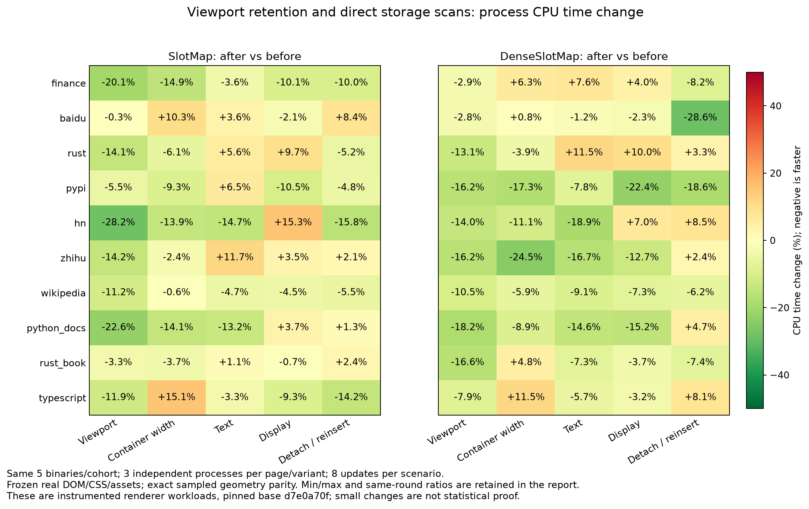
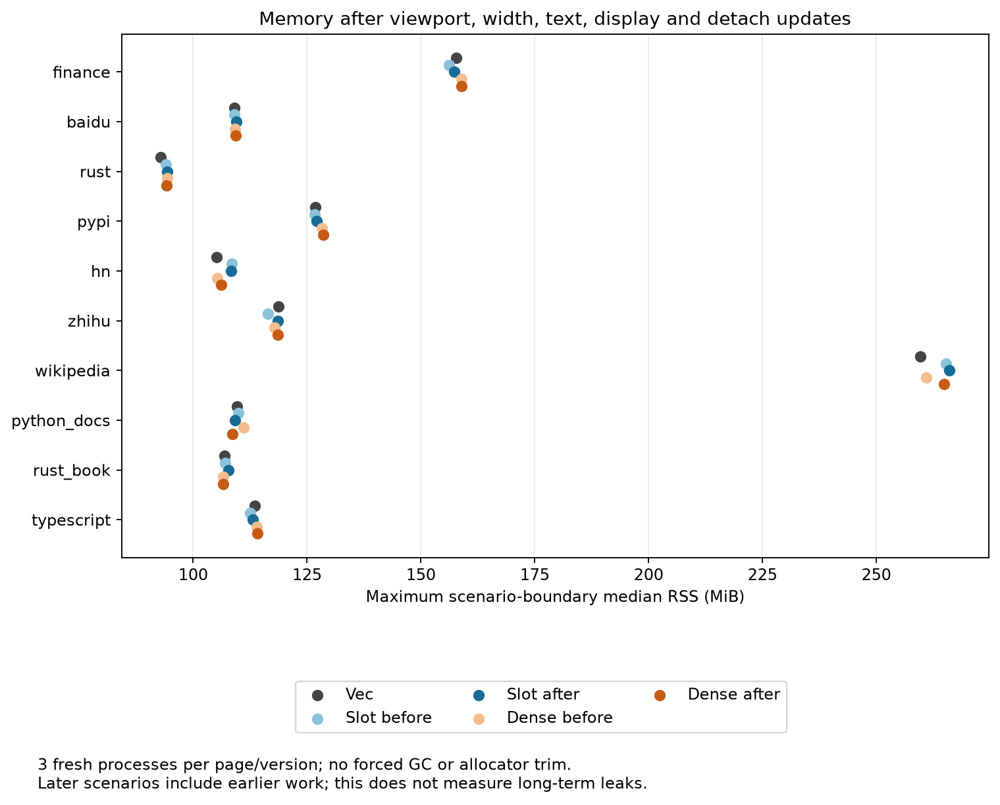

# Viewport retention and direct storage scans

150/150 fresh-process trials; 10 admitted page snapshots; 6,000 measured updates. Vec, both previous arena binaries and both updated binaries are tested together in the same cohort.

Viewport changes retain compatible box identities and shaped IFC inputs, revalidate all styles, and invalidate old numeric constraints. Root style changes can refresh compatible containers. Clearly unordered scans now use storage iteration; numeric feedback snapshots restore the same physical order with a revision check. IFC owner indices use compact generational arrays. Geometry publication keeps the existing ordered traversal and parent-ID conversion. No new numeric IDs or dense-reference array are introduced.

The same initialized DOM, CSS and assets are replayed with application scripts inert. All five versions use fresh processes, rotated order, identical settings, DPR 1, and the same five scenario families as the prior report. Each scenario warms once, then runs 8 updates (two cycles). These bounded renderer workloads do not measure live application resize handlers or long-term leaks.

Each update forces geometry. Up to 1,000 visible rectangles, body/target bounds, viewport and DOM/text counts match exactly between variants and rounds. Each family restores its starting state. Missing assets, failures and geometry differences remain failed records. No forced GC or allocator trim is used.

CPU comes from the POSIX all-thread process clock; CPU activity uses 100%=one logical CPU. Full geometry collection is outside timed steps, but deferred/background work inside those windows is counted. RSS/PSS are sampled every 100 ms and at boundaries. Later memory phases include earlier work; kernel high-water is since process startup. Small differences and broad/zero-crossing paired ranges are not statistical proof.

## CPU changes

Equal-page geometric mean of per-page median CPU ratios. Negative is faster. Before/after percentages compare the same backend within this new cohort, not historical measurements.

| Scenario | Slot after vs before | Dense after vs before | Slot after vs Vec | Dense after vs Vec |
|---|---:|---:|---:|---:|
| Viewport resize | -13.6% | -12.0% | -9.2% | -10.5% |
| Container width | -4.4% | -5.4% | +5.0% | +5.1% |
| Text changes | -1.4% | -6.7% | +6.1% | +1.2% |
| Display changes | -0.8% | -5.1% | +7.8% | +3.2% |
| Detach / reinsert | -4.4% | -4.9% | +5.2% | -0.9% |

## Reading the results

Aggregate same-backend CPU time improves in every paired round for both backends for: Viewport resize. See the paired-round table for the direction and range of other changes; this does not isolate an intrinsic container effect.

There is no broad RSS reduction. Across pages, the median change in maximum scenario-boundary RSS is SlotMap after +0.46 MiB (page range -0.71 … +2.05); DenseSlotMap after +0.15 MiB (page range -2.33 … +3.90).

Viewport residence can increase substantially earlier in the sequence. For wikipedia, SlotMap after viewport-boundary RSS 220.14 → 256.14 MiB, maximum across all scenario boundaries 265.24 → 266.04 MiB; DenseSlotMap after viewport-boundary RSS 222.59 → 262.76 MiB, maximum across all scenario boundaries 260.91 → 264.82 MiB. Both observations matter when choosing a CPU/memory tradeoff.

## Memory across the five scenarios

MiB; the maximum of the five scenario-boundary RSS medians for each page/version. This is a bounded workload with no forced GC, not a retained-object or long-term leak measurement. PSS, kernel high-water and JS heap used/total are also exported per scenario in the numeric files.

| Page | Vec | Slot before | Slot after | Dense before | Dense after |
|---|---:|---:|---:|---:|---:|
| finance | 157.72 | 156.14 | 157.36 | 158.86 | 158.88 |
| baidu | 109.04 | 109.07 | 109.45 | 109.19 | 109.29 |
| rust | 92.91 | 93.96 | 94.25 | 94.32 | 94.18 |
| pypi | 126.80 | 126.66 | 127.13 | 128.25 | 128.53 |
| hn | 105.14 | 108.43 | 108.30 | 105.34 | 106.20 |
| zhihu | 118.68 | 116.48 | 118.54 | 117.89 | 118.56 |
| wikipedia | 259.73 | 265.24 | 266.04 | 260.91 | 264.82 |
| python_docs | 109.64 | 109.93 | 109.21 | 111.00 | 108.67 |
| rust_book | 106.89 | 106.96 | 107.74 | 106.53 | 106.52 |
| typescript | 113.58 | 112.58 | 113.03 | 113.95 | 114.14 |

## Viewport resize

Process CPU ms per update; medians of 3 independent processes per variant/page.

| Page | Vec | Slot before → after | Dense before → after | Slot RSS before → after MiB | Dense RSS before → after MiB |
|---|---:|---:|---:|---:|---:|
| finance | 128.264 | 120.723 → 96.498 | 101.989 → 99.076 | 143.77 → 154.66 | 154.70 → 156.24 |
| baidu | 12.257 | 11.239 → 11.200 | 12.517 → 12.164 | 103.69 → 104.50 | 104.16 → 104.71 |
| rust | 11.834 | 11.568 → 9.933 | 11.378 → 9.884 | 86.74 → 87.34 | 87.04 → 87.29 |
| pypi | 27.327 | 29.698 → 28.074 | 31.588 → 26.459 | 123.45 → 126.60 | 117.57 → 127.99 |
| hn | 27.716 | 34.195 → 24.562 | 27.723 → 23.847 | 101.04 → 101.70 | 101.26 → 101.73 |
| zhihu | 24.689 | 28.410 → 24.375 | 27.151 → 22.753 | 112.61 → 114.93 | 112.75 → 114.94 |
| wikipedia | 271.181 | 283.560 → 251.764 | 291.589 → 260.948 | 220.14 → 256.14 | 222.59 → 262.76 |
| python_docs | 20.339 | 24.015 → 18.592 | 23.671 → 19.363 | 103.60 → 104.98 | 103.88 → 104.95 |
| rust_book | 18.136 | 17.436 → 16.854 | 19.003 → 15.852 | 100.85 → 100.58 | 101.15 → 100.50 |
| typescript | 21.590 | 22.767 → 20.049 | 19.573 → 18.033 | 104.60 → 110.03 | 108.93 → 110.12 |

## Container width

Process CPU ms per update; medians of 3 independent processes per variant/page.

| Page | Vec | Slot before → after | Dense before → after | Slot RSS before → after MiB | Dense RSS before → after MiB |
|---|---:|---:|---:|---:|---:|
| finance | 86.105 | 97.886 → 83.283 | 79.246 → 84.237 | 153.99 → 155.81 | 154.20 → 156.99 |
| baidu | 6.818 | 7.096 → 7.826 | 7.934 → 7.995 | 109.07 → 109.29 | 109.19 → 109.29 |
| rust | 5.971 | 6.309 → 5.924 | 5.740 → 5.514 | 90.53 → 90.72 | 90.68 → 90.55 |
| pypi | 22.835 | 29.327 → 26.602 | 31.543 → 26.078 | 126.66 → 127.13 | 128.25 → 128.47 |
| hn | 14.522 | 17.762 → 15.298 | 18.047 → 16.041 | 100.40 → 98.41 | 100.23 → 99.66 |
| zhihu | 11.699 | 13.384 → 13.061 | 15.076 → 11.377 | 111.45 → 110.40 | 110.23 → 107.62 |
| wikipedia | 290.301 | 299.097 → 297.291 | 316.571 → 297.937 | 256.41 → 260.95 | 258.59 → 263.44 |
| python_docs | 15.622 | 18.094 → 15.534 | 21.264 → 19.370 | 101.32 → 104.62 | 102.06 → 108.46 |
| rust_book | 13.222 | 13.341 → 12.848 | 12.789 → 13.401 | 103.54 → 103.75 | 103.85 → 103.83 |
| typescript | 13.713 | 12.947 → 14.904 | 12.096 → 13.487 | 107.48 → 113.03 | 112.76 → 112.22 |

## Text changes

Process CPU ms per update; medians of 3 independent processes per variant/page.

| Page | Vec | Slot before → after | Dense before → after | Slot RSS before → after MiB | Dense RSS before → after MiB |
|---|---:|---:|---:|---:|---:|
| finance | 56.289 | 59.481 → 57.322 | 47.383 → 50.965 | 155.50 → 157.36 | 158.86 → 158.88 |
| baidu | 5.410 | 5.599 → 5.803 | 5.411 → 5.347 | 100.84 → 109.45 | 102.51 → 105.16 |
| rust | 6.676 | 6.486 → 6.849 | 6.356 → 7.085 | 93.96 → 94.25 | 94.32 → 94.18 |
| pypi | 19.197 | 20.103 → 21.408 | 19.835 → 18.290 | 126.22 → 122.07 | 127.11 → 123.11 |
| hn | 12.852 | 15.856 → 13.525 | 18.446 → 14.957 | 104.84 → 105.19 | 105.34 → 105.13 |
| zhihu | 8.711 | 9.287 → 10.373 | 11.742 → 9.775 | 116.48 → 117.26 | 116.70 → 115.85 |
| wikipedia | 199.293 | 223.415 → 212.884 | 226.280 → 205.710 | 258.13 → 262.46 | 260.91 → 264.82 |
| python_docs | 18.699 | 20.127 → 17.463 | 20.328 → 17.358 | 108.77 → 105.17 | 107.52 → 106.69 |
| rust_book | 11.785 | 11.821 → 11.951 | 11.904 → 11.038 | 101.27 → 101.39 | 101.49 → 99.81 |
| typescript | 12.157 | 14.358 → 13.881 | 13.756 → 12.976 | 109.88 → 110.13 | 110.37 → 110.15 |

## Display changes

Process CPU ms per update; medians of 3 independent processes per variant/page.

| Page | Vec | Slot before → after | Dense before → after | Slot RSS before → after MiB | Dense RSS before → after MiB |
|---|---:|---:|---:|---:|---:|
| finance | 48.695 | 50.030 → 44.972 | 44.517 → 46.280 | 156.14 → 148.44 | 158.03 → 154.12 |
| baidu | 5.020 | 5.185 → 5.075 | 5.114 → 4.998 | 104.68 → 104.30 | 105.33 → 103.57 |
| rust | 5.322 | 5.270 → 5.780 | 5.168 → 5.683 | 87.93 → 88.27 | 88.18 → 88.30 |
| pypi | 16.383 | 17.809 → 15.936 | 19.456 → 15.104 | 125.98 → 125.61 | 123.29 → 128.53 |
| hn | 11.596 | 12.708 → 14.646 | 14.750 → 15.786 | 108.43 → 108.30 | 100.79 → 106.20 |
| zhihu | 10.898 | 12.754 → 13.198 | 13.012 → 11.363 | 116.35 → 118.54 | 117.89 → 118.56 |
| wikipedia | 147.010 | 162.309 → 155.016 | 157.318 → 145.797 | 265.24 → 266.04 | 252.96 → 256.84 |
| python_docs | 10.474 | 13.148 → 13.632 | 13.223 → 11.214 | 109.93 → 109.21 | 111.00 → 108.67 |
| rust_book | 11.688 | 12.103 → 12.023 | 12.207 → 11.751 | 106.96 → 107.74 | 106.53 → 106.52 |
| typescript | 10.762 | 11.762 → 10.667 | 10.792 → 10.451 | 112.58 → 112.58 | 112.61 → 112.66 |

## Detach / reinsert

Process CPU ms per update; medians of 3 independent processes per variant/page.

| Page | Vec | Slot before → after | Dense before → after | Slot RSS before → after MiB | Dense RSS before → after MiB |
|---|---:|---:|---:|---:|---:|
| finance | 55.033 | 58.316 → 52.459 | 53.553 → 49.148 | 155.43 → 151.00 | 149.43 → 153.64 |
| baidu | 10.258 | 9.583 → 10.385 | 10.519 → 7.516 | 107.47 → 107.09 | 108.57 → 107.69 |
| rust | 5.292 | 5.887 → 5.578 | 4.950 → 5.115 | 90.12 → 90.51 | 90.34 → 90.50 |
| pypi | 19.129 | 24.384 → 23.219 | 24.846 → 20.223 | 122.80 → 121.29 | 122.73 → 122.81 |
| hn | 12.476 | 15.622 → 13.155 | 13.225 → 14.345 | 101.15 → 107.87 | 102.57 → 100.82 |
| zhihu | 12.419 | 14.269 → 14.574 | 14.269 → 14.616 | 113.57 → 110.87 | 112.08 → 113.03 |
| wikipedia | 156.625 | 176.111 → 166.349 | 166.818 → 156.513 | 257.73 → 256.67 | 258.25 → 260.89 |
| python_docs | 10.948 | 11.575 → 11.727 | 11.386 → 11.926 | 102.59 → 102.93 | 104.00 → 104.75 |
| rust_book | 10.304 | 11.913 → 12.202 | 11.836 → 10.963 | 99.82 → 101.64 | 100.21 → 98.81 |
| typescript | 12.721 | 11.936 → 10.241 | 10.294 → 11.132 | 107.40 → 104.37 | 113.95 → 114.14 |

## Work retained during viewport updates

Average retained boxes / reused IFC contexts per update, then median across runs. Numeric outputs are invalidated on viewport changes; preserving shaped inputs does not authorize reuse of old sizes.

| Page | Slot before | Slot after | Dense before | Dense after |
|---|---:|---:|---:|---:|
| finance | 0.0 / 0.0 | 0.0 / 0.0 | 1237.5 / 167.1 | 1237.5 / 167.1 |
| baidu | 0.0 / 0.0 | 0.0 / 0.0 | 54.0 / 10.0 | 54.0 / 10.0 |
| rust | 0.0 / 0.0 | 0.0 / 0.0 | 76.0 / 13.4 | 76.0 / 13.4 |
| pypi | 0.0 / 0.0 | 0.0 / 0.0 | 36.2 / 5.1 | 36.2 / 5.1 |
| hn | 0.0 / 0.0 | 0.0 / 0.0 | 705.0 / 46.5 | 705.0 / 46.5 |
| zhihu | 0.0 / 0.0 | 0.0 / 0.0 | 640.0 / 133.0 | 640.0 / 133.0 |
| wikipedia | 0.0 / 0.0 | 0.0 / 0.0 | 40.0 / 0.5 | 40.0 / 0.5 |
| python_docs | 0.0 / 0.0 | 0.0 / 0.0 | 40.5 / 1.5 | 40.5 / 1.5 |
| rust_book | 0.0 / 0.0 | 0.0 / 0.0 | 75.5 / 7.0 | 75.5 / 7.0 |
| typescript | 0.0 / 0.0 | 0.0 / 0.0 | 131.2 / 22.6 | 131.2 / 22.6 |

## Viewport native phase timings

Median native wall milliseconds per update, before → after. These instrumented wall timers locate work; they do not partition all-thread process CPU time. The bundle includes viewport reuse, direct scans and compact IFC owner lookup, so this does not isolate an intrinsic container effect.

| Page | Backend | Box tree | Inline preparation | Numeric layout | Projection |
|---|---|---:|---:|---:|---:|
| finance | SlotMap after | 51.590 → 39.726 | 14.942 → 10.918 | 33.218 → 28.128 | 7.266 → 6.040 |
| finance | DenseSlotMap after | 44.829 → 39.030 | 13.619 → 10.295 | 27.762 → 28.865 | 5.396 → 5.563 |
| baidu | SlotMap after | 5.013 → 5.232 | 0.822 → 0.699 | 1.468 → 1.461 | 0.308 → 0.337 |
| baidu | DenseSlotMap after | 5.697 → 5.433 | 0.880 → 0.746 | 1.650 → 1.538 | 0.376 → 0.345 |
| rust | SlotMap after | 4.048 → 3.273 | 1.550 → 1.108 | 2.665 → 2.398 | 0.762 → 0.686 |
| rust | DenseSlotMap after | 4.058 → 3.321 | 1.534 → 1.114 | 2.636 → 2.450 | 0.703 → 0.689 |
| pypi | SlotMap after | 9.711 → 8.133 | 3.141 → 3.139 | 4.214 → 4.431 | 2.333 → 1.857 |
| pypi | DenseSlotMap after | 10.970 → 8.270 | 3.543 → 3.140 | 4.745 → 4.165 | 1.947 → 1.647 |
| hn | SlotMap after | 14.781 → 10.141 | 3.424 → 1.463 | 10.979 → 9.124 | 1.749 → 1.434 |
| hn | DenseSlotMap after | 11.875 → 9.535 | 2.821 → 1.366 | 9.111 → 8.795 | 1.452 → 1.477 |
| zhihu | SlotMap after | 11.275 → 9.892 | 4.711 → 1.956 | 6.793 → 6.540 | 1.459 → 1.635 |
| zhihu | DenseSlotMap after | 10.522 → 9.249 | 4.500 → 1.954 | 6.751 → 6.191 | 1.375 → 1.384 |
| wikipedia | SlotMap after | 124.007 → 101.671 | 45.230 → 44.235 | 63.691 → 62.444 | 28.070 → 26.164 |
| wikipedia | DenseSlotMap after | 128.982 → 108.394 | 47.412 → 44.584 | 66.093 → 63.828 | 30.336 → 26.471 |
| python_docs | SlotMap after | 7.752 → 4.855 | 6.828 → 5.332 | 4.510 → 3.949 | 2.041 → 1.655 |
| python_docs | DenseSlotMap after | 7.557 → 5.156 | 6.733 → 5.492 | 4.365 → 4.047 | 1.777 → 1.768 |
| rust_book | SlotMap after | 7.632 → 6.551 | 2.305 → 1.972 | 3.913 → 4.106 | 1.209 → 1.503 |
| rust_book | DenseSlotMap after | 8.233 → 6.090 | 2.457 → 1.878 | 4.317 → 3.900 | 1.397 → 1.385 |
| typescript | SlotMap after | 7.684 → 6.311 | 3.490 → 2.163 | 6.868 → 6.389 | 1.421 → 1.451 |
| typescript | DenseSlotMap after | 6.486 → 5.954 | 3.139 → 2.089 | 5.873 → 5.995 | 1.152 → 1.312 |

## Aggregate paired rounds

Equal-page geometric mean of each round's same-backend before/after CPU ratios. All three rounds are shown; these are not confidence intervals.

| Scenario | SlotMap rounds 1 / 2 / 3 | DenseSlotMap rounds 1 / 2 / 3 |
|---|---:|---:|
| Viewport resize | -8.8% / -14.8% / -16.0% | -14.8% / -17.9% / -7.6% |
| Container width | +2.3% / -9.3% / -0.3% | +1.7% / -9.6% / +5.3% |
| Text changes | -2.1% / +1.4% / +0.3% | -14.3% / -9.2% / +2.2% |
| Display changes | +2.0% / -4.8% / +3.6% | -4.7% / -7.2% / +1.8% |
| Detach / reinsert | -4.3% / -4.9% / +7.7% | +2.7% / -5.3% / -7.5% |

## Same-round CPU ratios

Median (min … max) percentage change versus the same backend before the followup. All original trials remain included.

| Page | Scenario | SlotMap | DenseSlotMap |
|---|---|---:|---:|
| finance | Viewport resize | -4.8% (-51.7 … -3.8) | -9.4% (-46.6 … +7.0) |
| finance | Container width | +6.9% (-14.9 … +9.4) | -1.2% (-13.3 … +16.7) |
| finance | Text changes | +7.9% (-13.9 … +22.8) | -9.7% (-66.6 … +26.8) |
| finance | Display changes | +0.9% (-12.5 … +15.6) | -5.6% (-44.6 … +12.3) |
| finance | Detach / reinsert | -0.1% (-20.2 … +12.2) | +1.4% (-21.4 … +8.4) |
| baidu | Viewport resize | -3.6% (-6.3 … +30.1) | -3.3% (-4.8 … +9.0) |
| baidu | Container width | +18.4% (+10.3 … +25.9) | +4.3% (-6.6 … +47.6) |
| baidu | Text changes | +23.7% (-27.5 … +30.7) | -5.1% (-13.4 … +9.1) |
| baidu | Display changes | +1.2% (-14.2 … +22.3) | -3.6% (-7.0 … +15.4) |
| baidu | Detach / reinsert | +1.2% (-2.8 … +28.3) | -15.8% (-31.0 … -1.4) |
| rust | Viewport resize | -10.3% (-20.8 … -9.4) | -12.2% (-16.2 … +11.7) |
| rust | Container width | +4.5% (-14.0 … +12.2) | +2.8% (-14.6 … +28.9) |
| rust | Text changes | +4.6% (+3.5 … +5.6) | +17.8% (-0.7 … +34.5) |
| rust | Display changes | +4.2% (-4.1 … +20.4) | +10.5% (+10.0 … +26.0) |
| rust | Detach / reinsert | +5.7% (-9.9 … +10.3) | +8.5% (-11.0 … +39.4) |
| pypi | Viewport resize | -10.4% (-33.1 … +13.9) | -16.2% (-41.0 … -0.8) |
| pypi | Container width | -22.3% (-29.1 … +12.3) | -17.8% (-19.7 … +4.8) |
| pypi | Text changes | +0.3% (-3.9 … +6.5) | -2.4% (-15.0 … +5.3) |
| pypi | Display changes | -8.5% (-25.0 … +15.0) | -5.5% (-26.9 … +4.1) |
| pypi | Detach / reinsert | -15.4% (-19.2 … -4.8) | -16.7% (-18.6 … +2.6) |
| hn | Viewport resize | -23.0% (-32.1 … -3.6) | -13.7% (-20.7 … -10.0) |
| hn | Container width | -13.9% (-30.5 … -10.8) | -4.4% (-11.1 … -2.4) |
| hn | Text changes | -5.6% (-18.2 … -1.0) | -16.6% (-18.9 … +9.8) |
| hn | Display changes | +5.8% (-9.1 … +25.4) | +7.0% (-4.3 … +9.5) |
| hn | Detach / reinsert | +5.1% (-23.8 … +8.2) | -8.9% (-9.0 … +8.5) |
| zhihu | Viewport resize | -14.2% (-16.8 … -14.2) | -16.2% (-29.0 … +6.3) |
| zhihu | Container width | +8.3% (-16.0 … +18.3) | +1.3% (-25.1 … +9.9) |
| zhihu | Text changes | +13.5% (-29.1 … +36.0) | -21.0% (-23.5 … +26.9) |
| zhihu | Display changes | +3.5% (-33.1 … +38.5) | -0.9% (-12.7 … +16.7) |
| zhihu | Detach / reinsert | +2.1% (-25.6 … +49.1) | +11.1% (+2.4 … +22.5) |
| wikipedia | Viewport resize | -6.9% (-12.2 … -5.8) | -10.5% (-12.5 … -8.2) |
| wikipedia | Container width | +0.4% (-4.3 … +2.5) | -3.2% (-8.6 … +3.7) |
| wikipedia | Text changes | -4.7% (-8.7 … +1.6) | -4.5% (-10.3 … +3.0) |
| wikipedia | Display changes | -4.5% (-4.7 … -3.1) | -7.2% (-9.5 … +2.9) |
| wikipedia | Detach / reinsert | -5.5% (-8.1 … +0.8) | -3.9% (-10.7 … +4.7) |
| python_docs | Viewport resize | -22.5% (-34.4 … -0.7) | -13.7% (-21.4 … -1.4) |
| python_docs | Container width | -7.5% (-18.6 … +3.0) | +0.6% (-10.7 … +9.2) |
| python_docs | Text changes | -6.4% (-13.2 … -1.2) | -0.9% (-16.7 … +0.5) |
| python_docs | Display changes | +1.4% (-1.2 … +18.4) | +2.0% (-15.2 … +9.5) |
| python_docs | Detach / reinsert | +4.9% (-0.7 … +27.1) | +1.0% (-5.0 … +4.9) |
| rust_book | Viewport resize | -14.0% (-16.9 … -3.3) | -13.9% (-46.9 … -10.7) |
| rust_book | Container width | -3.0% (-4.6 … +7.4) | +4.8% (-40.2 … +6.1) |
| rust_book | Text changes | +1.1% (-4.2 … +18.3) | -7.3% (-37.8 … +0.9) |
| rust_book | Display changes | -0.7% (-6.4 … +20.9) | +0.5% (-33.9 … +5.1) |
| rust_book | Detach / reinsert | +2.4% (-18.1 … +14.3) | -7.4% (-33.5 … +6.6) |
| typescript | Viewport resize | -11.9% (-21.1 … +6.7) | -7.2% (-10.2 … -5.6) |
| typescript | Container width | -4.4% (-7.2 … +16.3) | +12.8% (+5.0 … +31.6) |
| typescript | Text changes | -3.3% (-9.7 … +2.7) | -5.7% (-6.8 … +0.7) |
| typescript | Display changes | -9.3% (-15.0 … -1.3) | -7.0% (-10.1 … -3.2) |
| typescript | Detach / reinsert | -10.5% (-18.1 … +32.4) | +0.9% (-9.3 … +8.9) |

## Validation and scope

The Rust variants independently pass formatting, workspace/all-target/all-feature Clippy and full default Nextest before their Rust commits. Exact counts and source revisions are recorded in the PR. Snapshot admission is separate from formal medians. All binary/control/input hashes, run-level observations, phase timings, CPU activity and RSS/PSS ranges are retained in the numeric files; original bodies/cookies stay local. The base remains d7e0a70f, so current-main synchronization and revalidation are required before merging either alternative.

